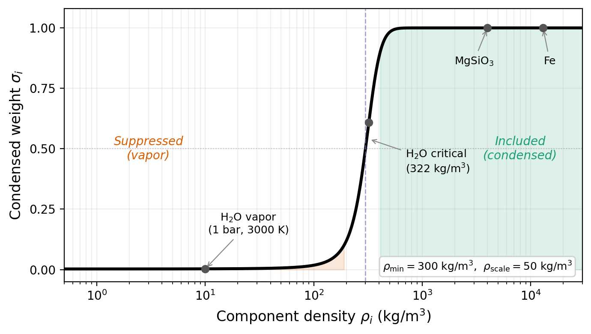

# Multi-Material Mixing

This page documents how Zalmoxis handles layers containing multiple materials, including the phase-aware density suppression that prevents non-condensed volatiles from dominating the mixture.
For configuration syntax, see the [configuration guide](../How-to/configuration.md#multi-material-mixing).
For the governing equations and layer architecture, see the [model overview](model.md).

---

## Volume-additive mixing

When a layer contains multiple materials (e.g., `"PALEOS:MgSiO3:0.85+PALEOS:H2O:0.15"`), the density at each radial shell is computed from the individual component densities at the local $(P, T)$.
Single-component layers use the component's density directly with no mixing overhead.

For multi-component layers, the standard volume-additive (ideal mixing) harmonic mean is:

$$
\rho_{\mathrm{mix}} = \left( \sum_i \frac{w_i}{\rho_i} \right)^{-1}
$$

where $w_i$ are mass fractions and $\rho_i(P, T)$ is each component's density evaluated independently from its own EOS table.
This assumes that partial specific volumes add linearly (no excess volume of mixing).

---

## Harmonic mean sensitivity to low-density components

The harmonic mean is dominated by the lightest component: even a small mass fraction of a low-density material can reduce $\rho_{\mathrm{mix}}$ dramatically.
At high temperatures and low pressures (near the planetary surface), H$_2$O transitions from condensed phases (liquid, ice) to vapor or low-density supercritical fluid with $\rho \sim 10$ to $100$ kg/m$^3$.
In a rock-water mixture with 85% MgSiO$_3$ ($\rho \sim 4000$ kg/m$^3$) and 15% H$_2$O ($\rho \sim 50$ kg/m$^3$), the standard harmonic mean gives $\rho_{\mathrm{mix}} \approx 311$ kg/m$^3$, far below the rock density that should dominate structurally.
The low-density vapor effectively inflates the planet's radius, producing non-physical results (e.g., $R \sim 24\,R_\oplus$ for a 10 $M_\oplus$ planet that should be $R \sim 2\,R_\oplus$).

Iron ($\rho > 7000$ kg/m$^3$) and MgSiO$_3$ ($\rho > 2500$ kg/m$^3$) exist only in condensed phases within the PALEOS tables and never trigger this problem.
Only H$_2$O and H$_2$ (via `Chabrier:H`) have gas-phase states in the current EOS tables. Future volatiles (CO$_2$, NH$_3$, He) would follow the same pattern.

---

## Sigmoid-weighted suppression of non-condensed components


*Condensed weight $\sigma_i$ as a function of component density. Low-density phases (vapor, supercritical gas) are smoothly suppressed; condensed phases (liquid, solid, rock, iron) are fully included. The sigmoid center is set near the H$_2$O critical density (322 kg/m$^3$).*

To prevent non-condensed volatiles from dominating the harmonic mean, each component's contribution is weighted by a smooth sigmoid function of its density:

$$
\sigma_i = \frac{1}{1 + \exp\!\left( -\frac{\rho_i - \rho_{\mathrm{min}}}{\rho_{\mathrm{scale}}} \right)}
$$

where $\rho_{\mathrm{min}}$ is the sigmoid center and $\rho_{\mathrm{scale}}$ controls the transition width.
The suppressed harmonic mean becomes:

$$
\rho_{\mathrm{mix}} = \frac{\sum_i w_i \, \sigma_i}{\sum_i w_i \, \sigma_i / \rho_i}
$$

This formulation has two key properties:

1. **When all $\sigma_i \approx 1$** (all components condensed), the expression reduces exactly to the standard harmonic mean.
   For iron ($\rho > 7000$) and MgSiO$_3$ ($\rho > 2500$), the sigmoid returns $\sigma \approx 1.0$ to machine precision, so existing single-material and all-condensed configurations produce numerically identical results.

2. **When $\sigma_i \to 0$** (component is vapor-like), both the numerator and denominator lose the $i$-th term proportionally, and the component drops out smoothly.
   There is no discontinuity, which is important for the adaptive ODE solver (RK45) that requires smooth right-hand-side functions.

The same sigmoid weighting is applied to the adiabatic gradient $\nabla_{\mathrm{ad}}$: components that are suppressed in the density calculation are also suppressed in the temperature profile calculation, maintaining internal consistency.

---

## Sigmoid parameters

The default parameters are calibrated for H$_2$O:

| Parameter | Default | Physical meaning |
|---|---|---|
| `condensed_rho_min` | 322 kg/m$^3$ | Sigmoid center = H$_2$O critical density (647 K, 22.1 MPa) |
| `condensed_rho_scale` | 50 kg/m$^3$ | Transition width; $\sigma$ goes from 0.02 to 0.98 over a range of about 390 kg/m$^3$ (~8$\times$ the scale) |

Behavior at representative densities:

| Density (kg/m$^3$) | Phase example | $\sigma$ |
|---|---|---|
| 10 | H$_2$O vapor at 1 bar, 3000 K | 0.002 |
| 100 | H$_2$O low-density supercritical | 0.012 |
| 322 | H$_2$O critical density (sigmoid center) | 0.500 |
| 500 | Dense supercritical H$_2$O | 0.972 |
| 1000 | Liquid H$_2$O at high $P$ | 1.000 |
| 4000 | MgSiO$_3$ | 1.000 |
| 13000 | Fe | 1.000 |

For H$_2$O, the defaults are appropriate.
For other volatiles, the code sets per-component values automatically (see table below).
The global `condensed_rho_min` and `condensed_rho_scale` parameters in the TOML config serve as fallbacks for any component not in the internal lookup table.

### Per-component defaults

!!! note "Per-component overrides are auto-set by the code"
    **Per-component overrides are auto-set by the code**, not user-tunable. The defaults are: Chabrier:H $\rightarrow$ 30 kg/m$^3$ (H$_2$ critical density), PALEOS:H2O $\rightarrow$ 322 kg/m$^3$ (H$_2$O critical density). The global `condensed_rho_min` (default 322 kg/m$^3$) is the fallback for any volatile not in the override table. See `src/zalmoxis/mixing.py` and the per-component table in `input/default.toml`.

| EOS component | `condensed_rho_min` (kg/m$^3$) | `condensed_rho_scale` (kg/m$^3$) | Physical basis |
|---|---|---|---|
| `Chabrier:H` | 30 | 10 | H$_2$ critical density (~31 kg/m$^3$). Narrow transition because the condensed/gas boundary is sharp. Set automatically by the code; no user config change needed. |
| `PALEOS:H2O` | 322 | 50 (global default) | H$_2$O critical density (647 K, 22.1 MPa). Uses the global `condensed_rho_scale` value. |
| `Seager2007:H2O` | 322 | 50 (global default) | Same as above. |
| All others | global config value | global config value | Iron and MgSiO$_3$ always have $\rho > 2500$ kg/m$^3$; the sigmoid returns $\sigma \approx 1.0$ to machine precision. |

Both the global fallback parameters are user-configurable in the `[EOS]` section of the TOML file (see [configuration](../How-to/configuration.md#phase-aware-mixing-parameters-multi-material-only)).

---

## Physical interpretation and known limitations

The suppressed harmonic mean is a pragmatic approximation, not a thermodynamically rigorous mixing model.
Several limitations should be understood when interpreting results:

### Mass non-conservation

When a component is suppressed ($\sigma \to 0$), its mass is excluded from the structural density calculation.
This is equivalent to treating vapor-phase volatiles as having negligible structural contribution, effectively discarding their mass from the hydrostatic equilibrium.
The approximation is valid when the suppressed fraction is small and the vapor does not contribute meaningfully to hydrostatic support.
For a mantle with 15% H$_2$O by mass, suppression primarily affects the outermost shells where pressure is low enough for H$_2$O to be vapor-like; at depth, the H$_2$O is condensed and fully included.

**Warning:** For configurations with large volatile mass fractions (e.g., > 30% H$_2$O or > 10% H$_2$), a substantial fraction of the input mass may be suppressed from the structure, leading to a planet whose structural mass is significantly less than the sum of the layer mass fractions times the total mass.
Users should verify that the suppressed mass fraction is acceptably small for their science case.
A future improvement could cap the volatile fraction at the input stage or redistribute suppressed mass across condensed components.

### Temperature profile consistency

The same suppression is applied to $\nabla_{\mathrm{ad}}$: when a component is suppressed in the density, its adiabatic gradient is also suppressed.
This means the temperature profile ignores the thermodynamic contribution of vapor-phase volatiles.
In reality, vapor affects heat transport and the temperature gradient.
This approximation is self-consistent within the model (the density and temperature calculations "see" the same effective mixture) but differs from the physical situation where vapor is present and thermodynamically active.

### Adiabatic gradient mixing

The mixed $\nabla_{\mathrm{ad}}$ is computed as a suppression-weighted linear combination of the component adiabatic gradients.
This is a simplification: even for ideal mixing, the true adiabatic coefficient of a multi-component system should be derived from the total entropy $S = \sum_i \chi_i S_i + S_{\mathrm{mix}}$ and its partial derivatives with respect to $P$ and $T$ ([Kempton et al. 2023, ApJ 953, 57, Appendix B](https://doi.org/10.3847/1538-4357/ace10d)).
The nonlinearity arises from the mixing entropy term and composition-dependent partial derivatives, and can produce deviations of hundreds of kelvin in deep temperature profiles for atmospheric gas mixtures.
In the context of Zalmoxis, this primarily affects layers that mix condensed materials (e.g., silicate + dissolved H$_2$) via additive volumes, which is a different thermodynamic regime from the atmospheric gas mixtures (additive partial pressures) treated by Kempton et al.
The linear approximation is standard in interior structure solvers for condensed-phase mixtures, but users should be aware that it does not capture composition-dependent corrections to the temperature gradient.

### Density-based criterion avoids phase-label ambiguity

Unlike approaches that classify each EOS grid cell as "condensed" or "non-condensed" using phase labels, the sigmoid operates on density alone.
This avoids ambiguity in the supercritical regime, where phase labels like "supercritical" span a wide range of densities: supercritical H$_2$O at 10 GPa and 3000 K has $\rho \sim 1200$ to $1400$ kg/m$^3$ (dense, liquid-like, correctly included), while supercritical H$_2$O at 1 bar and 3000 K has $\rho \sim 1$ kg/m$^3$ (gas-like, correctly suppressed).
A density-based criterion handles this naturally without consulting phase tables.

---

## Binodal (miscibility) suppression for sub-Neptune interiors

When H$_2$ is mixed with silicate or water (e.g., `"PALEOS:MgSiO3:0.97+Chabrier:H:0.03"`), a density-based sigmoid alone is insufficient.
H$_2$ may be dense enough to pass the density sigmoid (especially at high pressures), yet still be thermodynamically immiscible with its partner material below the miscibility boundary (the binodal).
A second sigmoid, based on the binodal temperature, determines whether H$_2$ participates in the structural density.

The total suppression weight for an H$_2$ component is the product of both sigmoids:

$$
\sigma_{\mathrm{total}} = \sigma_{\mathrm{density}} \times \sigma_{\mathrm{binodal}}
$$

where $\sigma_{\mathrm{density}}$ is the density-based sigmoid described above, and $\sigma_{\mathrm{binodal}}$ is the binodal (miscibility) sigmoid.
When the temperature is above the binodal, $\sigma_{\mathrm{binodal}} \approx 1$ and H$_2$ is included.
When below, $\sigma_{\mathrm{binodal}} \to 0$ and H$_2$ is excluded.
The transition is smooth, controlled by the `binodal_T_scale` parameter (default 50 K, giving a ~200 K transition zone).

Two independent binodal models are available. Both are evaluated automatically when `Chabrier:H` is present in a mixture. The most restrictive (lowest) suppression weight wins.
For the full physics, see the [binodal documentation](binodal.md).

### H$_2$-MgSiO$_3$ miscibility: Rogers+2025

The H$_2$-MgSiO$_3$ binodal from [Rogers, Young & Schlichting (2025, MNRAS 544, 3496)](https://doi.org/10.1093/mnras/staf1940) defines the phase boundary between a miscible supercritical fluid (above) and immiscible gas + melt (below).
The binodal temperature varies with H$_2$ mole fraction and pressure:

- At 1 GPa, the peak binodal temperature is ~4100 K (at the critical mole fraction $x_\mathrm{c} = 0.74$).
- At 10 GPa, it drops to ~3000 K (higher pressure promotes mixing).
- Above 35 GPa, H$_2$ and MgSiO$_3$ are always miscible ($T_\mathrm{c} \leq 0$).

This model applies when `Chabrier:H` coexists with any MgSiO$_3$ EOS in the same layer.

### H$_2$-H$_2$O miscibility: Gupta+2025

The H$_2$-H$_2$O critical curve from [Gupta, Stixrude & Schlichting (2025, ApJL 982, L35)](https://doi.org/10.3847/2041-8213/adb631) uses an asymmetric Margules Gibbs free energy model.
The critical temperature depends on pressure (via the interaction parameter $W(T, P)$).

A floor of 647 K is imposed on the critical temperature.
Below 647 K, H$_2$O condenses to liquid or ice, and the Margules model (fitted to supercritical DFT-MD data) is not valid.
H$_2$ and condensed H$_2$O are always immiscible, so the floor ensures correct suppression for cold sub-Neptune models with condensed water layers.

This model applies when `Chabrier:H` coexists with any H$_2$O EOS in the same layer.

---

## Phase-aware volatile partitioning

A volatile dissolved in a mantle that is part solid and part molten can be apportioned between the two silicate phases in more than one way.
The apportionment is a modeling choice (the partition rule), set by the `partition_rule` key in the `[EOS]` section.
Different rules encode different assumptions about where a volatile resides; the framework treats them uniformly by expressing each as a per-phase mass-fraction split $(w_{\mathrm{liquid}}, w_{\mathrm{solid}})$ that the `VolatileProfile` class in `src/zalmoxis/mixing.py` blends at every radial shell according to the local melt fraction $\phi(r)$:

$$
w_i(r) = \phi(r)\, w_{\mathrm{liquid}}[i] + \bigl(1 - \phi(r)\bigr)\, w_{\mathrm{solid}}[i]
$$

The primary silicate carries the remainder, $w_{\mathrm{sil}}(r) = 1 - \sum_i w_i(r)$.
The resulting per-shell $w_i(r)$ feed the same suppressed harmonic mean (and the same $\nabla_{\mathrm{ad}}$ mixing) as any single-composition layer, so a partition rule changes only how the bulk inventory is distributed with depth, not the density closure itself.

Two rules are implemented, with two further hooks reserved for prescriptions that need additional physics.
The bulk inventory $X_i$ is read from the mantle EOS-string fractions (e.g., `"PALEOS:MgSiO3:0.85+PALEOS:H2O:0.15"` gives $X_{\mathrm{H_2O}} = 0.15$); there is no separate inventory key.

| `partition_rule` | $(w_{\mathrm{liquid}}, w_{\mathrm{solid}})$ | Constraint |
|---|---|---|
| `uniform` (default) | $w_{\mathrm{liquid}} = w_{\mathrm{solid}} = X_i$ | None; melt-fraction-independent |
| `strong` | $w_{\mathrm{solid}} = 0,\ \ w_{\mathrm{liquid}} = X_i / \bar{\phi}$ | $\bar{\phi} \geq \sum_i X_i$ (mass-fraction bound) |
| `D_const` | constant partition coefficient $D_i$ per species | Reserved hook; raises `NotImplementedError` |
| `solubility` | pressure-dependent solubility law (Henry- or Bower-style) | Reserved hook; raises `NotImplementedError` |

### Uniform spread

`uniform` assigns the same mass fraction to both phases, so $w_i(r) = X_i$ at every shell independent of melt fraction.
It is the default and is byte-for-byte identical to the existing single-EOS-string behavior, so any config that does not set `partition_rule` is unaffected.

### Strong partition

`strong` assigns the entire volatile inventory to the silicate melt: $w_{\mathrm{solid}} = 0$ and $w_{\mathrm{liquid}} = X_i / \bar{\phi}$, with $\bar{\phi}$ the mass-weighted mantle melt fraction.
The per-shell fraction is then $w_i(r) = \phi(r)\, X_i / \bar{\phi}$, which integrates back to $X_i$ over the mantle, so the bulk inventory is conserved when $\bar{\phi}$ is consistent with the converged structure.
Because $\bar{\phi}$ is both an input to the rule and an output of the solve, `solver.solve_strong_partition` wraps the structure solve in an outer self-consistency loop on $\bar{\phi}$, dispatched from `output.post_processing`.

The mass-fraction bound $w_{\mathrm{liquid}} \leq 1$ requires $\bar{\phi} \geq \sum_i X_i$: a mantle cannot localize more volatile in its melt than the melt can carry.
The implementation enforces a floor $\bar{\phi}_{\mathrm{floor}} = 1.01 \sum_i X_i$ (a 1% numerical margin away from the $w_{\mathrm{liquid}} = 1$ singularity), below which `strong` reduces to the uniform spread, since a nearly-solid mantle cannot hold the whole inventory in melt.
The floor follows from the inventory and is not user-tunable.

!!! note "The two prescriptions give almost identical radius signals at the present EOS fidelity"
    With the current volume-additive density closure, the `uniform` and `strong` prescriptions yield planet radii that agree to well within any practical measurement precision ($\lesssim 10^{-6}\ R_\oplus$ across the sub-Neptune validation grid). Redistributing a fixed volatile mass between solid and molten shells leaves the mass–radius relation essentially unchanged, because PALEOS water is either vapor (suppressed by the density sigmoid) or already compressed to within ~30% of silicate, so concentrating it in the melt rearranges little that the radius integral resolves. The choice of partition rule is therefore consequential for the chemistry coupling (surface speciation, melt-driven outgassing) rather than for the structure. A structurally distinguishable signal would require an EOS that keeps dissolved water volumetrically distinct from silicate, such as an explicit low-density hydrous-melt phase or a partial-molar-volume model. That is the physics the reserved `D_const` and `solubility` hooks are intended to carry.

---

## Light-element core

A core layer can carry H, C, N, O, Si and S as `CoreAlloy:<element>` components next to one iron base, which must be `PALEOS:iron`:

```toml
core = "PALEOS:iron:0.96+CoreAlloy:H:0.005+CoreAlloy:O:0.02+CoreAlloy:Si:0.015"
```

Such a core does not use the harmonic mean and the vapour sigmoid above. `zalmoxis.eos.core_alloy` takes the iron density $\rho_\mathrm{Fe}(P, T)$ from the PALEOS table and changes it with the light-element mass fractions $w_i$; the core adiabat stays that of iron. The JAX structure path holds one core table, so a light-element core is solved on the numpy path.

**Linear law.** For C, N, O, Si, S and `H-linear`, each element lowers the density by $\beta_i$ percent per wt% ([Li et al. 2019](https://doi.org/10.1017/9781108677950.003), Table 3.3):

$$\rho_\mathrm{lin} = \rho_\mathrm{Fe}\,\Bigl(1 - \sum_i \beta_i\, w_i\Bigr),$$

with $\beta$ = 1.3 (C), 1.1 (O), 0.7 (Si) and 0.8 (S), the values for the liquid at the core-mantle boundary. The table gives no liquid value for H, so `CoreAlloy:H-linear` uses the solid value 8.7, and no value for N, so N does not change the density.

**Fe-H-O member.** `CoreAlloy:H` uses the liquid Fe (64 Fe) and Fe-water (64 Fe + 8 H$_2$O) equations of state of [Luo et al. (2024)](https://doi.org/10.1038/s41550-024-02347-z), Methods Eq. 14. Their volume difference at the same $(P, T)$, per kg of water, is the excess specific volume $\Delta v_c$ of a water carrier in liquid iron. The core H enters as this carrier, mass fraction $w_c = w_\mathrm{H} M_{\mathrm{H_2O}} / (2 M_\mathrm{H}) = 8.94\, w_\mathrm{H}$. The carrier O, $w_c - w_\mathrm{H} = 7.94\, w_\mathrm{H}$, counts against the core O; the rest of the O, $w_\mathrm{O} - 7.94\, w_\mathrm{H}$, enters the linear law with $\beta_\mathrm{O}$, also when it is negative because the core holds less O than the carrier. The linear law then applies to the alloy without the carrier, with fractions $w_i / (1 - w_c)$, and

$$\frac{1}{\rho} = \frac{1 - w_c}{\rho_\mathrm{lin}} + w_c\, \Delta v_c(P, T).$$

The density is continuous in $w_\mathrm{H}$ and $w_\mathrm{O}$, also where the O rest changes sign. To first order, a negative O rest splits $\Delta v_c$ into an H part and the linear-law O part. In a core with no O, 1 wt% H then lowers the density by an effective $\beta_\mathrm{H}$ = 12.83 % at 136 GPa and 8000 K (with the Luo dry Fe density there, 10389.8 kg/m$^3$), against the solid linear value of 8.7 %.

**Fit range.** The Luo fits cover 8000 to 14000 K and 50 to 1300 GPa. Outside that box, $\Delta v_c$ takes its value at the nearest point of the box, while the iron base stays at the true $(P, T)$; the first such point in a process gives a warning. The core-mantle boundary of Earth-like planets and super-Earths, at about 4000 to 6000 K, lies below the box, so there the carrier volume is its 8000 K value. At 136 GPa and 4000 K that is 3.28 $\times 10^{-4}$ m$^3$/kg, 8.4 % above the 3.03 $\times 10^{-4}$ m$^3$/kg that Eq. 14 gives when extrapolated to 4000 K; at low pressure and temperature the dry Fe fit has no volume at all, for example below 11 GPa at 3000 K and below 5.5 GPa at 4500 K. Inside the box:

| $\Delta v_c$ (10$^{-4}$ m$^3$/kg) | 50 GPa | 136 GPa | 360 GPa | 1300 GPa |
|---|---|---|---|---|
| 8000 K | 4.36 | 3.28 | 2.30 | 1.31 |
| 11000 K | 4.70 | 3.46 | 2.42 | 1.39 |
| 14000 K | 5.19 | 3.63 | 2.54 | 1.47 |

**Composition range.** The Luo wet cell has a carrier mass fraction of 0.0388 (0.43 wt% H); above it $\Delta v_c$ is used beyond the composition of the fit, and the first such core in a process gives a warning. The $\beta$ values and both Luo members describe liquid iron; at nodes where the PALEOS iron table is solid (for example 136 GPa and 4000 K) the same laws apply.

The split of $\Delta v_c$ into an H part and a linear-law O part is first order in the O rest of the remaining alloy, $(w_\mathrm{O} - 7.94\, w_\mathrm{H}) / (1 - w_c)$. A core whose O rest is below -0.2 raises `CoreAlloyError`; with no core O that is $w_\mathrm{H}$ above 0.0206. The Luo cell (-0.036) and 1 wt% H (-0.087) lie inside the bound. Core density over the PALEOS iron density for the carrier, at the outermost core node of the default 1 $M_\oplus$ pure-iron structure (141.96 GPa, 5205 K) and at 135 GPa and 4000 K (all fractions are mass fractions; 0.0252 is the core O of the 50 GPa case of Tsutsumi et al. 2025):

| $w_\mathrm{H}$ | $w_\mathrm{O}$ | $w_c$ | O rest / $(1 - w_c)$ | $\rho/\rho_\mathrm{Fe}$, 141.96 GPa, 5205 K | $\rho/\rho_\mathrm{Fe}$, 135 GPa, 4000 K |
|---|---|---|---|---|---|
| 0.0043 | 0.0 | 0.0384 | -0.0355 | 0.9416 | 0.9359 |
| 0.01 | 0.0 | 0.0894 | -0.0871 | 0.8706 | 0.8594 |
| 0.02 | 0.0 | 0.1787 | -0.1933 | 0.7619 | 0.7448 |
| 0.05 | 0.0 | 0.4468 | -0.7173 | refused | refused |
| 0.0043 | 0.0252 | 0.0384 | -0.0093 | 0.9188 | 0.9133 |
| 0.01 | 0.0252 | 0.0894 | -0.0595 | 0.8530 | 0.8422 |
| 0.02 | 0.0252 | 0.1787 | -0.1626 | 0.7508 | 0.7342 |
| 0.05 | 0.0252 | 0.4468 | -0.6717 | refused | refused |

The fractions of a light-element core are given explicitly for every component, including the iron base, and sum to 1. A composition with no iron left, a carrier fraction of 1 or more ($w_\mathrm{H} \geq 1/8.94 = 0.1119$), a linear law without positive density, a negative or non-finite fraction, a base other than `PALEOS:iron`, two iron bases or both H forms raises `CoreAlloyError`, as does a density at or below zero. The [equation-of-state validation page](../Validation/equation_of_state.md) holds the test cases.

---

## Future extensions

The mixing framework supports several planned extensions without requiring changes to the upstream solver code:

- Depth-dependent fractions via the `LayerMixture.update_fractions()` interface (already supported for PROTEUS/CALLIOPE coupling).
- Non-ideal mixing corrections (excess volume) in `calculate_mixed_density()` for mantle mixtures.
- H$_2$O-MgSiO$_3$ binodal suppression, once a generalizable miscibility model for this system becomes available.
- Additional volatile EOS (He, CO$_2$, NH$_3$) with their own per-component sigmoid parameters.
- Physically-motivated partition laws (`D_const`, `solubility`) plugging into the `partition_rule` hook, together with a low-density hydrous-melt phase or partial-molar-volume treatment for dissolved water.
