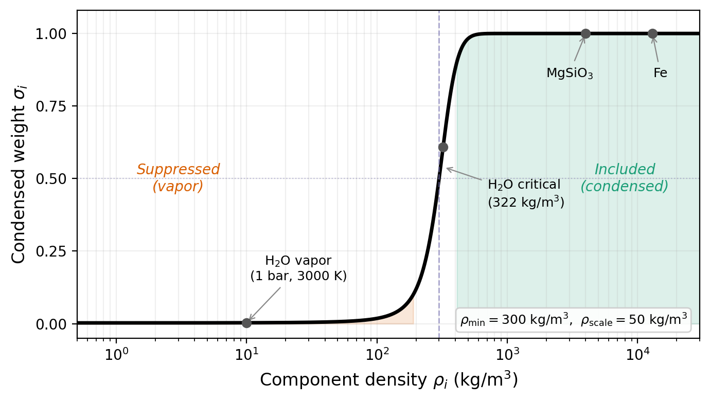

# Multi-Material Mixing

This page documents how Zalmoxis handles layers containing multiple materials, including the phase-aware density suppression that prevents non-condensed volatiles from dominating the mixture.
For configuration syntax, see the [configuration guide](../How-to/configuration.md#multi-material-mixing).
For the governing equations and layer architecture, see the [model overview](model.md).

---

## Volume-additive mixing

When a layer contains multiple materials (e.g., `"PALEOS:MgSiO3:0.85+PALEOS:H2O:0.15"`), the density at each radial shell is computed from the individual component densities at the local $(P, T)$.
Single-component layers use the component's density directly with no mixing overhead.

For multi-component layers, the standard volume-additive (ideal mixing) harmonic mean is:

$$
\rho_{\mathrm{mix}} = \left( \sum_i \frac{w_i}{\rho_i} \right)^{-1}
$$

where $w_i$ are mass fractions and $\rho_i(P, T)$ is each component's density evaluated independently from its own EOS table.
This assumes that partial specific volumes add linearly (no excess volume of mixing).

---

## Harmonic mean sensitivity to low-density components

The harmonic mean is dominated by the lightest component: even a small mass fraction of a low-density material can reduce $\rho_{\mathrm{mix}}$ dramatically.
At high temperatures and low pressures (near the planetary surface), H$_2$O transitions from condensed phases (liquid, ice) to vapor or low-density supercritical fluid with $\rho \sim 10$ to $100$ kg/m$^3$.
In a rock-water mixture with 85% MgSiO$_3$ ($\rho \sim 4000$ kg/m$^3$) and 15% H$_2$O ($\rho \sim 50$ kg/m$^3$), the standard harmonic mean gives $\rho_{\mathrm{mix}} \approx 311$ kg/m$^3$, far below the rock density that should dominate structurally.
The low-density vapor effectively inflates the planet's radius, producing non-physical results (e.g., $R \sim 24\,R_\oplus$ for a 10 $M_\oplus$ planet that should be $R \sim 2\,R_\oplus$).

Iron ($\rho > 7000$ kg/m$^3$) and MgSiO$_3$ ($\rho > 2500$ kg/m$^3$) exist only in condensed phases within the PALEOS tables and never trigger this problem.
Only H$_2$O and H$_2$ (via `Chabrier:H`) have gas-phase states in the current EOS tables. Future volatiles (CO$_2$, NH$_3$, He) would follow the same pattern.

---

## Sigmoid-weighted suppression of non-condensed components


*Condensed weight $\sigma_i$ as a function of component density. Low-density phases (vapor, supercritical gas) are smoothly suppressed; condensed phases (liquid, solid, rock, iron) are fully included. The sigmoid center is set near the H$_2$O critical density (322 kg/m$^3$).*

To prevent non-condensed volatiles from dominating the harmonic mean, each component's contribution is weighted by a smooth sigmoid function of its density:

$$
\sigma_i = \frac{1}{1 + \exp\!\left( -\frac{\rho_i - \rho_{\mathrm{min}}}{\rho_{\mathrm{scale}}} \right)}
$$

where $\rho_{\mathrm{min}}$ is the sigmoid center and $\rho_{\mathrm{scale}}$ controls the transition width.
The suppressed harmonic mean becomes:

$$
\rho_{\mathrm{mix}} = \frac{\sum_i w_i \, \sigma_i}{\sum_i w_i \, \sigma_i / \rho_i}
$$

This formulation has two key properties:

1. **When all $\sigma_i \approx 1$** (all components condensed), the expression reduces exactly to the standard harmonic mean.
   For iron ($\rho > 7000$) and MgSiO$_3$ ($\rho > 2500$), the sigmoid returns $\sigma \approx 1.0$ to machine precision, so existing single-material and all-condensed configurations produce numerically identical results.

2. **When $\sigma_i \to 0$** (component is vapor-like), both the numerator and denominator lose the $i$-th term proportionally, and the component drops out smoothly.
   There is no discontinuity, which is important for the adaptive ODE solver (RK45) that requires smooth right-hand-side functions.

The same sigmoid weighting is applied to the adiabatic gradient $\nabla_{\mathrm{ad}}$: components that are suppressed in the density calculation are also suppressed in the temperature profile calculation, maintaining internal consistency.

---

## Sigmoid parameters

The default parameters are calibrated for H$_2$O:

| Parameter | Default | Physical meaning |
|---|---|---|
| `condensed_rho_min` | 322 kg/m$^3$ | Sigmoid center = H$_2$O critical density (647 K, 22.1 MPa) |
| `condensed_rho_scale` | 50 kg/m$^3$ | Transition width; $\sigma$ goes from 0.02 to 0.98 over a range of about 390 kg/m$^3$ (~8$\times$ the scale) |

Behavior at representative densities:

| Density (kg/m$^3$) | Phase example | $\sigma$ |
|---|---|---|
| 10 | H$_2$O vapor at 1 bar, 3000 K | 0.002 |
| 100 | H$_2$O low-density supercritical | 0.012 |
| 322 | H$_2$O critical density (sigmoid center) | 0.500 |
| 500 | Dense supercritical H$_2$O | 0.972 |
| 1000 | Liquid H$_2$O at high $P$ | 1.000 |
| 4000 | MgSiO$_3$ | 1.000 |
| 13000 | Fe | 1.000 |

For H$_2$O, the defaults are appropriate.
For other volatiles, the code sets per-component values automatically (see table below).
The global `condensed_rho_min` and `condensed_rho_scale` parameters in the TOML config serve as fallbacks for any component not in the internal lookup table.

### Per-component defaults

!!! note "Per-component overrides are auto-set by the code"
    **Per-component overrides are auto-set by the code**, not user-tunable. The defaults are: Chabrier:H $\rightarrow$ 30 kg/m$^3$ (H$_2$ critical density), PALEOS:H2O $\rightarrow$ 322 kg/m$^3$ (H$_2$O critical density). The global `condensed_rho_min` (default 322 kg/m$^3$) is the fallback for any volatile not in the override table. See `src/zalmoxis/mixing.py` and the per-component table in `input/default.toml`.

| EOS component | `condensed_rho_min` (kg/m$^3$) | `condensed_rho_scale` (kg/m$^3$) | Physical basis |
|---|---|---|---|
| `Chabrier:H` | 30 | 10 | H$_2$ critical density (~31 kg/m$^3$). Narrow transition because the condensed/gas boundary is sharp. Set automatically by the code; no user config change needed. |
| `PALEOS:H2O` | 322 | 50 (global default) | H$_2$O critical density (647 K, 22.1 MPa). Uses the global `condensed_rho_scale` value. |
| `Seager2007:H2O` | 322 | 50 (global default) | Same as above. |
| All others | global config value | global config value | Iron and MgSiO$_3$ always have $\rho > 2500$ kg/m$^3$; the sigmoid returns $\sigma \approx 1.0$ to machine precision. |

Both the global fallback parameters are user-configurable in the `[EOS]` section of the TOML file (see [configuration](../How-to/configuration.md#phase-aware-mixing-parameters-multi-material-only)).

---

## Physical interpretation and known limitations

The suppressed harmonic mean is a pragmatic approximation, not a thermodynamically rigorous mixing model.
Several limitations should be understood when interpreting results:

### Mass non-conservation

When a component is suppressed ($\sigma \to 0$), its mass is excluded from the structural density calculation.
This is equivalent to treating vapor-phase volatiles as having negligible structural contribution, effectively discarding their mass from the hydrostatic equilibrium.
The approximation is valid when the suppressed fraction is small and the vapor does not contribute meaningfully to hydrostatic support.
For a mantle with 15% H$_2$O by mass, suppression primarily affects the outermost shells where pressure is low enough for H$_2$O to be vapor-like; at depth, the H$_2$O is condensed and fully included.

**Warning:** For configurations with large volatile mass fractions (e.g., > 30% H$_2$O or > 10% H$_2$), a substantial fraction of the input mass may be suppressed from the structure, leading to a planet whose structural mass is significantly less than the sum of the layer mass fractions times the total mass.
Users should verify that the suppressed mass fraction is acceptably small for their science case.
A future improvement could cap the volatile fraction at the input stage or redistribute suppressed mass across condensed components.

### Temperature profile consistency

The same suppression is applied to $\nabla_{\mathrm{ad}}$: when a component is suppressed in the density, its adiabatic gradient is also suppressed.
This means the temperature profile ignores the thermodynamic contribution of vapor-phase volatiles.
In reality, vapor affects heat transport and the temperature gradient.
This approximation is self-consistent within the model (the density and temperature calculations "see" the same effective mixture) but differs from the physical situation where vapor is present and thermodynamically active.

### Adiabatic gradient mixing

The mixed $\nabla_{\mathrm{ad}}$ is computed as a suppression-weighted linear combination of the component adiabatic gradients.
This is a simplification: even for ideal mixing, the true adiabatic coefficient of a multi-component system should be derived from the total entropy $S = \sum_i \chi_i S_i + S_{\mathrm{mix}}$ and its partial derivatives with respect to $P$ and $T$ ([Kempton et al. 2023, ApJ 953, 57, Appendix B](https://doi.org/10.3847/1538-4357/ace10d)).
The nonlinearity arises from the mixing entropy term and composition-dependent partial derivatives, and can produce deviations of hundreds of kelvin in deep temperature profiles for atmospheric gas mixtures.
In the context of Zalmoxis, this primarily affects layers that mix condensed materials (e.g., silicate + dissolved H$_2$) via additive volumes, which is a different thermodynamic regime from the atmospheric gas mixtures (additive partial pressures) treated by Kempton et al.
The linear approximation is standard in interior structure solvers for condensed-phase mixtures, but users should be aware that it does not capture composition-dependent corrections to the temperature gradient.

### Density-based criterion avoids phase-label ambiguity

Unlike approaches that classify each EOS grid cell as "condensed" or "non-condensed" using phase labels, the sigmoid operates on density alone.
This avoids ambiguity in the supercritical regime, where phase labels like "supercritical" span a wide range of densities: supercritical H$_2$O at 10 GPa and 3000 K has $\rho \sim 1200$ to $1400$ kg/m$^3$ (dense, liquid-like, correctly included), while supercritical H$_2$O at 1 bar and 3000 K has $\rho \sim 1$ kg/m$^3$ (gas-like, correctly suppressed).
A density-based criterion handles this naturally without consulting phase tables.

---

## Binodal (miscibility) suppression for sub-Neptune interiors

When H$_2$ is mixed with silicate or water (e.g., `"PALEOS:MgSiO3:0.97+Chabrier:H:0.03"`), a density-based sigmoid alone is insufficient.
H$_2$ may be dense enough to pass the density sigmoid (especially at high pressures), yet still be thermodynamically immiscible with its partner material below the miscibility boundary (the binodal).
A second sigmoid, based on the binodal temperature, determines whether H$_2$ participates in the structural density.

The total suppression weight for an H$_2$ component is the product of both sigmoids:

$$
\sigma_{\mathrm{total}} = \sigma_{\mathrm{density}} \times \sigma_{\mathrm{binodal}}
$$

where $\sigma_{\mathrm{density}}$ is the density-based sigmoid described above, and $\sigma_{\mathrm{binodal}}$ is the binodal (miscibility) sigmoid.
When the temperature is above the binodal, $\sigma_{\mathrm{binodal}} \approx 1$ and H$_2$ is included.
When below, $\sigma_{\mathrm{binodal}} \to 0$ and H$_2$ is excluded.
The transition is smooth, controlled by the `binodal_T_scale` parameter (default 50 K, giving a ~200 K transition zone).

Two independent binodal models are available. Both are evaluated automatically when `Chabrier:H` is present in a mixture. The most restrictive (lowest) suppression weight wins.
For the full physics, see the [binodal documentation](binodal.md).

### H$_2$-MgSiO$_3$ miscibility: Rogers+2025

The H$_2$-MgSiO$_3$ binodal from [Rogers, Young & Schlichting (2025, MNRAS 544, 3496)](https://doi.org/10.1093/mnras/staf1940) defines the phase boundary between a miscible supercritical fluid (above) and immiscible gas + melt (below).
The binodal temperature varies with H$_2$ mole fraction and pressure:

- At 1 GPa, the peak binodal temperature is ~4100 K (at the critical mole fraction $x_\mathrm{c} = 0.74$).
- At 10 GPa, it drops to ~3000 K (higher pressure promotes mixing).
- Above 35 GPa, H$_2$ and MgSiO$_3$ are always miscible ($T_\mathrm{c} \leq 0$).

This model applies when `Chabrier:H` coexists with any MgSiO$_3$ EOS in the same layer.

### H$_2$-H$_2$O miscibility: Gupta+2025

The H$_2$-H$_2$O critical curve from [Gupta, Stixrude & Schlichting (2025, ApJL 982, L35)](https://doi.org/10.3847/2041-8213/adb631) uses an asymmetric Margules Gibbs free energy model.
The critical temperature depends on pressure (via the interaction parameter $W(T, P)$).

A floor of 647 K is imposed on the critical temperature.
Below 647 K, H$_2$O condenses to liquid or ice, and the Margules model (fitted to supercritical DFT-MD data) is not valid.
H$_2$ and condensed H$_2$O are always immiscible, so the floor ensures correct suppression for cold sub-Neptune models with condensed water layers.

This model applies when `Chabrier:H` coexists with any H$_2$O EOS in the same layer.

---

## Phase-aware volatile partitioning

A volatile dissolved in a mantle that is part solid and part molten can be apportioned between the two silicate phases in more than one way.
The apportionment is a modeling choice (the partition rule), set by the `partition_rule` key in the `[EOS]` section.
Different rules encode different assumptions about where a volatile resides; the framework treats them uniformly by expressing each as a per-phase mass-fraction split $(w_{\mathrm{liquid}}, w_{\mathrm{solid}})$ that the `VolatileProfile` class in `src/zalmoxis/mixing.py` blends at every radial shell according to the local melt fraction $\phi(r)$:

$$
w_i(r) = \phi(r)\, w_{\mathrm{liquid}}[i] + \bigl(1 - \phi(r)\bigr)\, w_{\mathrm{solid}}[i]
$$

The primary silicate carries the remainder, $w_{\mathrm{sil}}(r) = 1 - \sum_i w_i(r)$.
The resulting per-shell $w_i(r)$ feed the same suppressed harmonic mean (and the same $\nabla_{\mathrm{ad}}$ mixing) as any single-composition layer, so a partition rule changes only how the bulk inventory is distributed with depth, not the density closure itself.

Two rules are implemented, with two further hooks reserved for prescriptions that need additional physics.
The bulk inventory $X_i$ is read from the mantle EOS-string fractions (e.g., `"PALEOS:MgSiO3:0.85+PALEOS:H2O:0.15"` gives $X_{\mathrm{H_2O}} = 0.15$); there is no separate inventory key.

| `partition_rule` | $(w_{\mathrm{liquid}}, w_{\mathrm{solid}})$ | Constraint |
|---|---|---|
| `uniform` (default) | $w_{\mathrm{liquid}} = w_{\mathrm{solid}} = X_i$ | None; melt-fraction-independent |
| `strong` | $w_{\mathrm{solid}} = 0,\ \ w_{\mathrm{liquid}} = X_i / \bar{\phi}$ | $\bar{\phi} \geq \sum_i X_i$ (mass-fraction bound) |
| `D_const` | constant partition coefficient $D_i$ per species | Reserved hook; raises `NotImplementedError` |
| `solubility` | pressure-dependent solubility law (Henry- or Bower-style) | Reserved hook; raises `NotImplementedError` |

### Uniform spread

`uniform` assigns the same mass fraction to both phases, so $w_i(r) = X_i$ at every shell independent of melt fraction.
It is the default and is byte-for-byte identical to the existing single-EOS-string behavior, so any config that does not set `partition_rule` is unaffected.

### Strong partition

`strong` assigns the entire volatile inventory to the silicate melt: $w_{\mathrm{solid}} = 0$ and $w_{\mathrm{liquid}} = X_i / \bar{\phi}$, with $\bar{\phi}$ the mass-weighted mantle melt fraction.
The per-shell fraction is then $w_i(r) = \phi(r)\, X_i / \bar{\phi}$, which integrates back to $X_i$ over the mantle, so the bulk inventory is conserved when $\bar{\phi}$ is consistent with the converged structure.
Because $\bar{\phi}$ is both an input to the rule and an output of the solve, `solver.solve_strong_partition` wraps the structure solve in an outer self-consistency loop on $\bar{\phi}$, dispatched from `output.post_processing`.

The mass-fraction bound $w_{\mathrm{liquid}} \leq 1$ requires $\bar{\phi} \geq \sum_i X_i$: a mantle cannot localize more volatile in its melt than the melt can carry.
The implementation enforces a floor $\bar{\phi}_{\mathrm{floor}} = 1.01 \sum_i X_i$ (a 1% numerical margin away from the $w_{\mathrm{liquid}} = 1$ singularity), below which `strong` reduces to the uniform spread, since a nearly-solid mantle cannot hold the whole inventory in melt.
The floor follows from the inventory and is not user-tunable.

!!! note "The two prescriptions give almost identical radius signals at the present EOS fidelity"
    With the current volume-additive density closure, the `uniform` and `strong` prescriptions yield planet radii that agree to well within any practical measurement precision ($\lesssim 10^{-6}\ R_\oplus$ across the sub-Neptune validation grid). Redistributing a fixed volatile mass between solid and molten shells leaves the mass–radius relation essentially unchanged, because PALEOS water is either vapor (suppressed by the density sigmoid) or already compressed to within ~30% of silicate, so concentrating it in the melt rearranges little that the radius integral resolves. The choice of partition rule is therefore consequential for the chemistry coupling (surface speciation, melt-driven outgassing) rather than for the structure. A structurally distinguishable signal would require an EOS that keeps dissolved water volumetrically distinct from silicate, such as an explicit low-density hydrous-melt phase or a partial-molar-volume model. That is the physics the reserved `D_const` and `solubility` hooks are intended to carry.

---

## Light-element core

A core layer can carry H, C, N, O, Si and S as `CoreAlloy:<element>` components next to one iron base, `PALEOS:iron` or one of the 2 iron side tables of the [two-layer core](#two-layer-core):

```toml
core = "PALEOS:iron:0.96+CoreAlloy:H:0.005+CoreAlloy:O:0.02+CoreAlloy:Si:0.015"
```

Such a core does not use the harmonic mean and the vapour sigmoid above. `zalmoxis.eos.core_alloy` takes the iron density $\rho_\mathrm{Fe}(P, T)$ from the PALEOS table and changes it with the light-element mass fractions $w_i$; the core adiabat stays that of iron. The JAX structure path holds one core table, so a core with a light-element fraction above 0 is solved on the numpy path; a core whose `CoreAlloy` fractions are all 0 stays on the JAX path as its iron base.

**Linear law.** For C, N, O, Si, S and H (`CoreAlloy:H`, the default H law), each element lowers the density by $\beta_i$ percent per wt%:

$$\rho_\mathrm{lin} = \rho_\mathrm{Fe}\,\Bigl(1 - \sum_i \beta_i\, w_i\Bigr),$$

[Hirose et al. (2021)](https://doi.org/10.1038/s43017-021-00203-6), p. 3, give 4 outer cores with a single light element that each fit the seismic outer core: 13.3-14.4 wt% S, 9.3-9.8 wt% Si, 8.4-8.9 wt% O or 0.96-0.99 wt% H, at 4137 K at the core-mantle boundary and 5400 K at the inner-core boundary; each is 6 to 8 % less dense than pure liquid iron. Their source, [Umemoto & Hirose (2020)](https://doi.org/10.1016/j.epsl.2019.116009), gives each range for one inner-core boundary temperature, 5400 K: it is the spread of single-element compositions that fit the PREM density and P-wave velocity within the errors of their calculation and the 2$\sigma$ seismic uncertainties, not a change between the 2 boundaries; with 4800 K the H range is 1.05-1.12 wt%. $\beta$ gives 7 % at the midpoint of each range: $\beta$ = 7/13.85 = 0.505 (S), 7/9.55 = 0.733 (Si), 7/8.65 = 0.809 (O) and 7/0.975 = 7.18 (H), so the ends of each range lie at 6.7 to 7.3 %. This is a calibration against liquid iron at Earth core pressures; at other pressures the law keeps the same $\beta$, and how $\beta$ changes with pressure is not known here (for comparison, the Luo H law below lowers the density of the Luo liquid iron at 8000 K by 13.2 % at 136 GPa and 11.0 % at 330 GPa for 0.975 wt% H). The law scales the density of the iron base it is given. Where the PALEOS iron table is solid, below the melting curve of pure iron, the base is solid iron: 2.3 % denser at 136 GPa and 4137 K and 1.2 % at 330 GPa and 5400 K than the liquid iron of Luo et al. (2024, Eq. 14), extrapolated there below its 8000 K fit range, so these offsets are differences between 2 fits. There a calibrated core is 4.9 and 5.8 % less dense than that liquid iron, not 7 %. C keeps the liquid value 1.3 of [Li et al. (2019)](https://doi.org/10.1017/9781108677950.003), Table 3.3, and N, with no value there, does not change the density; neither is calibrated against the outer core.

**Fe-H-O member.** `CoreAlloy:H-Luo` uses the liquid Fe (64 Fe) and Fe-water (64 Fe + 8 H$_2$O) equations of state of [Luo et al. (2024)](https://doi.org/10.1038/s41550-024-02347-z), Methods Eq. 14. Their volume difference at the same $(P, T)$, per kg of water, is the excess specific volume $\Delta v_c$ of a water carrier in liquid iron. The core H enters as this carrier, mass fraction $w_c = w_\mathrm{H} M_{\mathrm{H_2O}} / (2 M_\mathrm{H}) = 8.94\, w_\mathrm{H}$. The carrier O, $w_c - w_\mathrm{H} = 7.94\, w_\mathrm{H}$, counts against the core O; the rest of the O, $w_\mathrm{O} - 7.94\, w_\mathrm{H}$, enters the linear law with $\beta_\mathrm{O}$, also when it is negative because the core holds less O than the carrier. The linear law then applies to the alloy without the carrier, with fractions $w_i / (1 - w_c)$, and

$$\frac{1}{\rho} = \frac{1 - w_c}{\rho_\mathrm{lin}} + w_c\, \Delta v_c(P, T).$$

The density is continuous in $w_\mathrm{H}$ and $w_\mathrm{O}$, also where the O rest changes sign. To first order, a negative O rest splits $\Delta v_c$ into an H part and the linear-law O part. In a core with no O at 136 GPa and 8000 K (with the Luo dry Fe density there, 10389.8 kg/m$^3$), H then lowers the density by an effective $\beta_\mathrm{H}$ of 15.14 % per wt% as $w_\mathrm{H} \to 0$, against the linear value of 7.18 %; 1 wt% H lowers it by 13.47 %. This effective value depends on $\beta_\mathrm{O}$, since the carrier brings O that the linear law subtracts again: with $\beta_\mathrm{O} = 1.1$ in place of the calibrated 0.809 it is 12.83 % per wt%. For the H core of Hirose et al. (2021), 0.96-0.99 wt% H with no O, this law gives 13.0-13.3 % at 136 GPa and 10.8-11.1 % at 330 GPa on the Luo liquid iron at 8000 K, and 14.9-15.3 % and 11.6-11.9 % on the PALEOS iron table at 4137 and 5400 K, where that table is solid: more than the 6-8 % of their estimate. `CoreAlloy:H` gives 6.9 to 7.1 % there, so for the same H content the Luo law gives 1.57 to 2.16 times the deficit of the linear law. The default H law is the calibrated linear law, `CoreAlloy:H`; `CoreAlloy:H-Luo` selects the carrier law. A core names at most one of the 2, and a core that names `CoreAlloy:H-linear` is refused with a message that names both.

**Fit range.** The Luo fits cover 8000 to 14000 K and 50 to 1300 GPa. Outside that box, $\Delta v_c$ takes its value at the nearest point of the box, while the iron base stays at the true $(P, T)$; the first such point in a process gives a warning. The core-mantle boundary of Earth-like planets and super-Earths, at about 4000 to 6000 K, lies below the box, so there the carrier volume is its 8000 K value. At 136 GPa and 4000 K that is 3.28 $\times 10^{-4}$ m$^3$/kg, 8.4 % above the 3.03 $\times 10^{-4}$ m$^3$/kg that Eq. 14 gives when extrapolated to 4000 K; at low pressure and temperature the dry Fe fit has no volume at all, for example below 11.075 GPa at 3000 K and below 5.545 GPa at 4500 K. Inside the box:

| $\Delta v_c$ (10$^{-4}$ m$^3$/kg) | 50 GPa | 136 GPa | 360 GPa | 1300 GPa |
|---|---|---|---|---|
| 8000 K | 4.36 | 3.28 | 2.30 | 1.31 |
| 11000 K | 4.70 | 3.46 | 2.42 | 1.39 |
| 14000 K | 5.19 | 3.63 | 2.54 | 1.47 |

**Composition range.** The Luo wet cell has a carrier mass fraction of 0.0388 (0.43 wt% H); above it $\Delta v_c$ is used beyond the composition of the fit, and the first such core in a process gives a warning. The $\beta$ values and both Luo members describe liquid iron; at nodes where the PALEOS iron table is solid (for example 136 GPa and 4000 K) the same laws apply.

The split of $\Delta v_c$ into an H part and a linear-law O part is first order in the O rest of the remaining alloy, $(w_\mathrm{O} - 7.94\, w_\mathrm{H}) / (1 - w_c)$. A core whose O rest is below -0.2 raises `CoreAlloyError`; with no core O that is $w_\mathrm{H}$ above 0.02057. The Luo cell (-0.036) and 1 wt% H (-0.087) lie inside the bound. Core density over the PALEOS iron density for the carrier, at the outermost core node (index 77 of 150 nodes, counted from 0) of the default 1 $M_\oplus$ pure-iron structure on the numpy path (about 136.6 GPa and 5130 K; this state varies by about 1e-4 between environments, within the round-off spread of the numpy structure solve) and at 135 GPa and 4000 K (all fractions are mass fractions; 0.0252 is the core O of the 50 GPa case of Tsutsumi et al. 2025):

| $w_\mathrm{H}$ | $w_\mathrm{O}$ | $w_c$ | O rest / $(1 - w_c)$ | $\rho/\rho_\mathrm{Fe}$, outermost core node | $\rho/\rho_\mathrm{Fe}$, 135 GPa, 4000 K |
|---|---|---|---|---|---|
| 0.0043 | 0.0 | 0.0384 | -0.0355 | 0.933 | 0.928 |
| 0.01 | 0.0 | 0.0894 | -0.0871 | 0.855 | 0.845 |
| 0.02 | 0.0 | 0.1787 | -0.1933 | 0.741 | 0.727 |
| 0.05 | 0.0 | 0.4468 | -0.7173 | refused | refused |
| 0.0043 | 0.0252 | 0.0384 | -0.0093 | 0.916 | 0.911 |
| 0.01 | 0.0252 | 0.0894 | -0.0595 | 0.842 | 0.832 |
| 0.02 | 0.0252 | 0.1787 | -0.1626 | 0.733 | 0.719 |
| 0.05 | 0.0252 | 0.4468 | -0.6717 | refused | refused |

**Linear-law bound.** Write $r = 1 - \mathrm{lin} = \rho_\mathrm{lin}/\rho_\mathrm{Fe}$ for the remaining alloy, $k = 8.94$ and $c_1 = k - \beta_\mathrm{O}(k - 1) = 2.514$. Then $\partial(1/\rho)/\partial w_\mathrm{H} = (c_1 - 2 k r)/(\rho_\mathrm{Fe} r^2) + k\,\Delta v_c$ at any $w_\mathrm{H}$, so the density rises with $w_\mathrm{H}$ only for $r$ between the 2 roots $\bigl(k \mp \sqrt{k^2 - \rho_\mathrm{Fe} k \Delta v_c c_1}\bigr)/(\rho_\mathrm{Fe} k \Delta v_c)$, the larger of which is $r^*$. Where $k^2 < \rho_\mathrm{Fe} k \Delta v_c c_1$ there is no root, and the density falls with $w_\mathrm{H}$ at every $r$. A core with $r$ below 0.8 raises `CoreAlloyError`, also without H. On the PALEOS iron base:

| State | $\rho_\mathrm{Fe}$ (kg/m$^3$) | $\Delta v_c$ (10$^{-4}$ m$^3$/kg) | $r^*$ |
|---|---|---|---|
| Outermost core node, default 1 $M_\oplus$, numpy path (about 136.6 GPa, 5130 K) | 10900 | 3.280 | no root |
| 135 GPa, 4000 K | 11304.25 | 3.2929 | no root |
| 136 GPa, 8000 K | 10389.75 | 3.2849 | 0.3515 |

Over 20-3000 GPa and 3000-14000 K, $r^*$ is at most 0.595, at 1300 GPa and 8000 K, the corner of the Luo fit box; on a grid of 160 log-spaced pressures by 120 temperatures, a fifth of the states have no root. Below 20 GPa (2000-16000 K) $r^*$ is at most 0.626, at 0.1 MPa and 8000 K, where the carrier volume is that of the box edge at 50 GPa. Above 14000 K the carrier volume is that of 14000 K and $r^*$ grows with temperature: over 20-3000 GPa it is at most 0.537 at 16000 K, 0.611 at 35000 K, 0.654 at 40000 K and 0.796 at 59000 K, and above 0.8 from 60000 K. The bound 0.8 therefore holds at every pressure for temperatures up to 16000 K, and above 20 GPa up to 59000 K. Alone in the remaining alloy, each element reaches the bound at 24.7 wt% O, 15.4 wt% C, 39.6 wt% S, 27.3 wt% Si and 2.79 wt% H. These limits lie above the end compounds of the binaries of the alloy liquidus. A core whose S, O and C together need more Fe than it holds in the units of the alloy liquidus (Fe$_3$S, FeO, and Fe$_3$C below 255 GPa or Fe$_7$C$_3$ at and above it, with all O counted as FeO) gives one warning per process, and its density is used. For one element alone this bound is 16.06 wt% S, 22.27 wt% O, or 6.69 and 8.44 wt% C. It is a bound on the Fe of the core: Si, H and N take no Fe but reduce the Fe mass, while the liquidus counts Si atoms with its solvent.

The fractions of a light-element core are given explicitly for every component, including the iron base, and sum to 1. A composition with no iron left, a carrier fraction of 1 or more ($w_\mathrm{H} \geq 1/8.94 = 0.1119$), a linear-law factor $1 - \mathrm{lin}$ below 0.8 (below), a negative or non-finite fraction, a base other than `PALEOS:iron` or an iron side table, two iron bases or both H laws raises `CoreAlloyError`, as does a density at or below zero. The [equation-of-state validation page](../Validation/equation_of_state.md) holds the test cases.

## Two-layer core

Which part of the core is solid, and which density does each part take? With `inner_core` set, the core has 2 layers. The inner core reads the solid side of PALEOS iron and the outer core the liquid side. The inner-core boundary (ICB) between them comes from an iron melting curve on the temperature profile, or from a given inner-core mass.

```toml
core          = "PALEOS-API-2phase:iron-liquid:0.8615+CoreAlloy:S:0.1385"
inner_core    = "PALEOS-API-2phase:iron-solid"
core_liquidus = "Anzellini13-iron"
```

**The 2 side tables.** `PALEOS-API-2phase:iron-solid` is the solid iron of PALEOS on every node: the phase of the PALEOS phase diagram without its melting test, so above the melting curve it is the metastable solid. `PALEOS-API-2phase:iron-liquid` is the PALEOS liquid of Luo et al. (2024) [^cite-luo2024] on every node, below the melting curve its metastable extension. Both tables cover the box of the unified iron table, $10^5$ to $10^{14}$ Pa and 300 to $10^5$ K, at 150 points per decade (1351 by 379 nodes). Zalmoxis makes them on first use in the PALEOS API cache, `$ZALMOXIS_ROOT/data/EOS_PALEOS_API/`, one pair per PALEOS version and build key, and reads each side as a unified table. Each layer can carry `CoreAlloy` light elements on its side, as in the [light-element core](#light-element-core); an inner core without them is pure iron.

**The ICB.** With `core_liquidus`, the ICB pressure $P_\mathrm{ICB}$ is the first root, from the centre outward, of

$$T(P) - T_\mathrm{liq}(P) = 0$$

on the temperature profile of the previous outer pass, found by Brent's method on the profile interpolated in $\ln P$. $T_\mathrm{liq}$ is a named iron melting curve (`Anzellini13-iron`, `Sinmyo19-iron`) or a callable `T_liq(P)` \[K\] that a caller such as PROTEUS sets as `core_liquidus` for the liquidus of the outer-core alloy. Core shells with an enclosed mass below the mass at $P_\mathrm{ICB}$ take `inner_core`, the others `core`. With `inner_core_mass_fraction` $f$, the inner core is the mass $f M_\mathrm{core}$ instead. With the liquidus rule, the outer loop stops only when the inner-core mass moves by less than `tolerance_outer` of the core mass between 2 passes. An accept path that skips this test (an iteration cap, a clock stop, an oscillation stop) returns `converged = False` and `icb_converged = False` when the ICB lies more than `tolerance_outer` of the core mass from the liquidus root of the returned profile, and `main` then retries instead of accepting it; such a retry can take minutes. The rule needs the Picard outer loop: a Newton probe solves 1 outer pass, with no profile of a previous pass, so `outer_solver = "newton"` refuses the liquidus rule and takes `inner_core_mass_fraction` only. Picard is the Zalmoxis default; PROTEUS defaults to Newton and must set Picard for the liquidus rule.

**Temperature.** The core temperature keeps the path of the one-layer core. The adiabatic gradient of each node comes from the side of its layer, and the temperature is continuous at the ICB, with no latent heat in the structure temperature.

**Core arrays.** Every solve whose profile reaches the core mass returns `result['core']` (otherwise it is `None`, as for a pass cut before its pressure solve): `r`, `m`, `P`, `rho`, `g`, `T` (m, kg, Pa, kg/m$^3$, m/s$^2$, K) at the core nodes plus a node at the core mass, the core-mantle boundary (CMB); `phase` per node (1 inner core, 0 outer core); `w_<el>` per light element; and `M_ic` \[kg\], `R_icb` \[m\], `P_icb` \[Pa\], `solid_above_icb_mass_fraction` and the flag `solid_above_icb`, all at the inner-core mass of the solved layers (`P_icb` is the pressure at `M_ic`); `w_layers` holds the light-element fractions of each layer. The CMB node comes from an event of the structure integration at the core mass. Every accepted solve asserts that this node holds the core mass to $10^{-10}$ (`core_cmb_node`), that each core-array density is that of its layer EOS to $10^{-6}$ (`core_density_eos`), that the light-element masses of the nodes equal $M_\mathrm{ic} w_\mathrm{ic} + M_\mathrm{oc} w_\mathrm{oc}$ of the layer compositions to $10^{-10}$ (`core_element_mass`) and that no core node lies outside the table of its side (`core_table_box`). The node at the core mass takes the layer of the core just below it for its density and phase.

**A worked example.** Take the default 1 $M_\oplus$ planet with the core of the example above. The adiabat from 3000 K at the surface reaches 7735 K at the centre, at 349 GPa, where the Anzellini curve is at 6403 K. The centre is above the liquidus, so the liquidus rule gives no inner core. With `inner_core_mass_fraction = 0.0508`, the value of PREM, the ICB lies at 1211 km and 322 GPa, and the density falls there from 13164 to 12049 kg/m$^3$. That inner core is solid at 7708 K at the centre, above the melting curve of iron: the mass rule sets the boundary, not the phase. On an isothermal 5000 K core the liquidus rule puts the ICB at 206 GPa, where the Anzellini curve is at 5000 K. The [tutorial](../Tutorials/two_layer_core.md) runs the first 2 cases.

**Where this is checked.** [Light-element outer cores on the liquid iron side](../Validation/equation_of_state.md#light-element-outer-cores-on-the-liquid-iron-side) and [the two-layer Earth core against PREM](../Validation/mass_radius.md#a-two-layer-earth-core-against-prem); the solves of `tests/test_core_two_phase_solve.py` check the ICB rules, the core arrays and the cores wholly above or below the liquidus.

**Bounds and what happens outside them.**

- **Layers.** A two-layer core needs the liquid side as the only iron base of `core` and the solid side as that of `inner_core`, in any order of the components. A liquid side in a core without an inner core, a layer on the wrong side or a component other than the iron side and `CoreAlloy` elements is refused with a `ValueError`.
- **ICB rule.** A two-layer core needs exactly one of `core_liquidus` and `inner_core_mass_fraction`; a one-layer core takes neither. `core_liquidus` needs the Picard outer loop and is refused with `outer_solver = "newton"`, also when a caller skips `validate_config`. `inner_core_mass_fraction` must be a number in $[0, 1]$, `core_liquidus` a named iron melting curve or a callable. Otherwise the configuration is refused.
- **Centre above the liquidus.** The core has no inner core ($M_\mathrm{ic} = 0$).
- **Whole core below the liquidus.** The whole core is the inner core.
- **Solid above the ICB.** Nodes above the ICB that lie below the liquidus, as in a profile that crosses the liquidus more than once, stay in the outer core. Their mass, as a fraction of the core mass, is `solid_above_icb_mass_fraction`, and `solid_above_icb` is set.
- **Named melting curve.** `Anzellini13-iron` and `Sinmyo19-iron` are melting curves of pure iron. S, O and C lower the melting point of iron: each binary has a eutectic, which melts below pure iron. At core pressures the Fe-S eutectic lies near 3550 K at 254 GPa, run 11 of Table 1 of Mori et al. (2017) [^cite-mori2017], and the Fe-C eutectic at about 3750 K at 330 GPa, extrapolated from data to 255 GPa in Sect. 4.1 of Mashino et al. (2019) [^cite-mashino2019], against 5497 and 6229 K on the Anzellini curve; Oka et al. (2019) [^cite-oka2019] measured the Fe-FeO eutectic to 204 GPa. An outer core with them can therefore melt below these curves, and the rule then gives too large an inner core. The solve warns for any outer core with `CoreAlloy` elements and a named curve. Pass the liquidus of the alloy as a callable instead.
- **Bulk composition.** The light-element fractions of each layer are inputs, so the light-element mass of the core, $M_\mathrm{ic} w_\mathrm{ic} + M_\mathrm{oc} w_\mathrm{oc}$, changes when the ICB moves: freezing does not move light elements from the inner to the outer core. For the 13.85 wt% S outer core of the default 1 $M_\oplus$ planet on an isothermal core with the Anzellini rule, the inner core holds 0.480 of the core mass at 5000 K and 0.159 at 5500 K, so the bulk S of the core is 7.20 and 11.65 wt% (`tests/test_core_two_phase_solve.py::test_the_bulk_s_of_the_core_follows_the_icb`). A caller that keeps the bulk composition, as an evolution model with element partitioning does, sets the layer fractions for each solve.
- **Start dependence.** With the liquidus rule on an adiabatic profile, the solve can hold 2 states near the surface temperature where the core starts to freeze. The likely cause is the shallower adiabat of the solid side: its adiabatic gradient is about half that of the liquid side at core states (0.19 against 0.38 at 140 GPa and 4500 K). For the 13.85 wt% S outer core of the default 1 $M_\oplus$ planet and the Anzellini curve, a scan in 25 K steps of the surface temperature, each solve started from the state of the step before, gives the inner-core mass fractions below. Inside this band the start (the density, radii and centre temperature that seed the solve) selects the state; outside it both directions agree.

    | Surface temperature | Walking down (from a liquid core) | Walking up (from a solid core) |
    | --- | --- | --- |
    | 2475 K | 1.000 | 1.000 |
    | 2500 K | 0.848 | 1.000 |
    | 2525 K | 0.000 | 0.308 |
    | 2550 K | 0.000 | 0.000 |

- **Tight outer tolerance.** With `core_liquidus`, the outer loop stops only when the total mass and the ICB mass both meet `tolerance_outer`, and near convergence one pass moves the ICB by about 0.4 to 2.1 times the change of the relative mass. Well below the default $10^{-3}$, both tests reach the jitter of the Picard iteration and can alternate, and the solve then returns `converged = False`. For the isothermal 5000 K core of the default 1 $M_\oplus$ planet with `max_iterations_outer = 2`, the first solve stops at its iteration cap and the tightened retry of `main` ($10^{-4}$, 4 passes, since the retry doubles the cap) ends with the ICB $8.8 \times 10^{-5}$ of the core mass off the root on macOS arm64, a 12 % margin, and $1.38 \times 10^{-4}$ off on an AMD EPYC 9V45. With `max_iterations_outer = 3` the retry runs 6 passes and does not converge on macOS arm64 either. A result with `converged = True` has its ICB within `tolerance_outer` of the root (`icb_converged`, `tests/test_core_two_phase_solve.py::test_an_accept_with_an_icb_off_the_liquidus_is_not_converged`).
- **Non-finite liquidus.** A temperature or a liquidus that is not finite on a core node is refused with a `ValueError`.
- **Outside a side table.** A core node outside the box of its side table, or where the table has no finite value, fails the accepted solve (`core_table_box`). The solid side has no value where the solid iron of PALEOS does not converge: on the default grid above about 2830 K below 0.1 GPa, 2960 K at 1 GPa, 3400 K at 5 GPa, 5310 K at 10 GPa and 6790 K at 20 GPa. An inner core of a small, hot planet can lie there, and its solve then fails.
- **JAX path.** The JAX structure path refuses an `inner_core` layer; a two-layer core is solved on the numpy path.

---

## Future extensions

The mixing framework supports several planned extensions without requiring changes to the upstream solver code:

- Depth-dependent fractions via the `LayerMixture.update_fractions()` interface (already supported for PROTEUS/CALLIOPE coupling).
- Non-ideal mixing corrections (excess volume) in `calculate_mixed_density()` for mantle mixtures.
- H$_2$O-MgSiO$_3$ binodal suppression, once a generalizable miscibility model for this system becomes available.
- Additional volatile EOS (He, CO$_2$, NH$_3$) with their own per-component sigmoid parameters.
- Physically-motivated partition laws (`D_const`, `solubility`) plugging into the `partition_rule` hook, together with a low-density hydrous-melt phase or partial-molar-volume treatment for dissolved water.

[^cite-luo2024]: H. Luo, C. Dorn, J. Deng (2024). *[The interior as the dominant water reservoir in super-Earths and sub-Neptunes](https://doi.org/10.1038/s41550-024-02347-z)*. Nature Astronomy.

[^cite-mashino2019]: I. Mashino, F. Miozzi, K. Hirose, G. Morard, R. Sinmyo (2019). *[Melting experiments on the Fe-C binary system up to 255 GPa: Constraints on the carbon content in the Earth's core](https://doi.org/10.1016/j.epsl.2019.03.020)*. Earth and Planetary Science Letters, 515, 135-144.

[^cite-mori2017]: Y. Mori, H. Ozawa, K. Hirose, R. Sinmyo, S. Tateno, G. Morard, Y. Ohishi (2017). *[Melting experiments on Fe-Fe3S system to 254 GPa](https://doi.org/10.1016/j.epsl.2017.02.021)*. Earth and Planetary Science Letters, 464, 135-141.

[^cite-oka2019]: K. Oka, K. Hirose, S. Tagawa, Y. Kidokoro, Y. Nakajima, Y. Kuwayama, G. Morard, N. Coudurier, G. Fiquet (2019). *[Melting in the Fe-FeO system to 204 GPa: Implications for oxygen in Earth's core](https://doi.org/10.2138/am-2019-7081)*. American Mineralogist, 104, 1603-1607.
