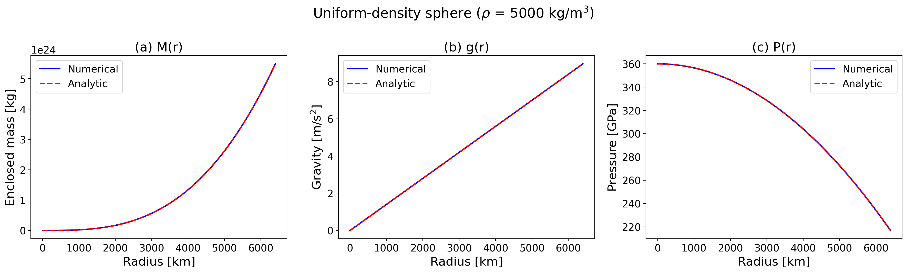
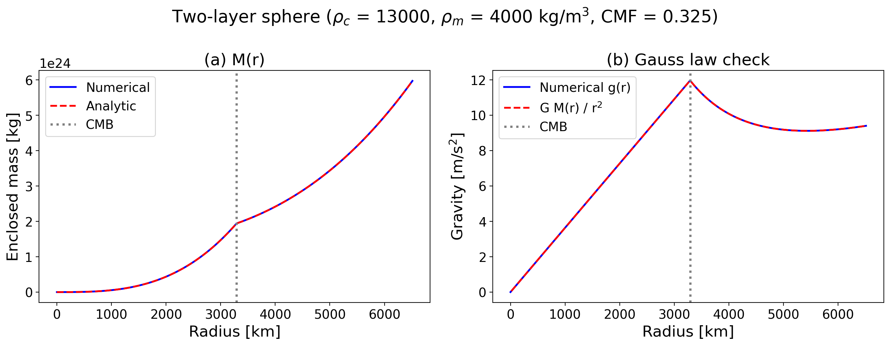
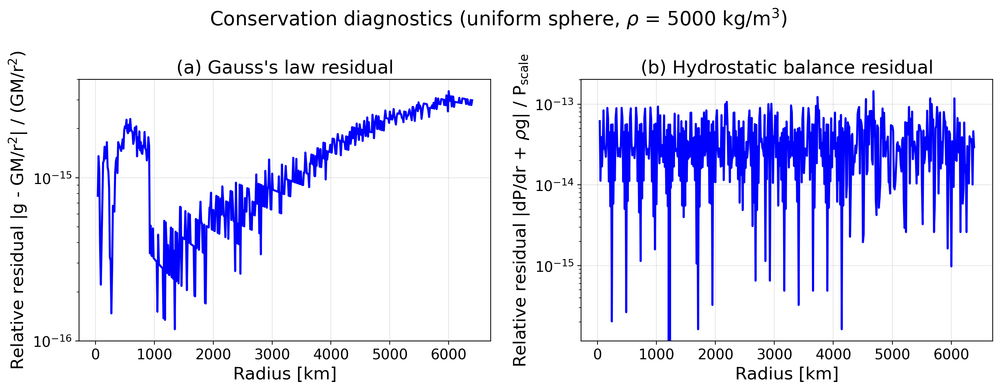
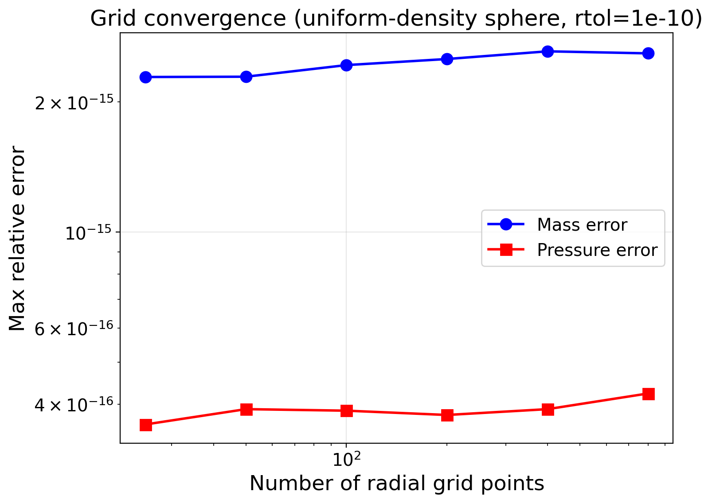

# Hydrostatic structure

These cases check the integration of the structure equations against closed-form solutions, conservation laws and a second implementation of the same equations. The [overview](index.md) lists every case of the tab.

## Governing equations

Zalmoxis solves three coupled ordinary differential equations for the radial structure of a self-gravitating, spherically symmetric body in hydrostatic equilibrium:

$$
\frac{dM}{dr} = 4\pi r^2 \rho(r)
$$

$$
\frac{dg}{dr} = 4\pi G \rho(r) - \frac{2\,g(r)}{r}
$$

$$
\frac{dP}{dr} = -\rho(r)\, g(r)
$$

where $M(r)$ is the enclosed mass, $g(r)$ is gravitational acceleration, $P(r)$ is pressure, and $\rho(r)$ is density. These are integrated outward from the center ($r = 0$) with initial conditions $M(0) = 0$, $g(0) = 0$, $P(0) = P_c$.

Note that the gravity equation is singular at $r = 0$ due to the $2g/r$ term. L'Hopital's rule gives the analytic limit $dg/dr|_{r=0} = \frac{4}{3}\pi G \rho_c$, which `coupled_odes` in `zalmoxis.structure_model` uses at $r = 0$.

The system is closed by an equation of state $\rho = \rho(P, T)$, but for verification purposes we either fix $\rho$ to a constant (Tests 1-4) or use the Seager et al. (2007) analytic polytrope $\rho(P) = \rho_0 + c P^n$ (Tests 5-7), both of which eliminate any dependence on tabulated EOS data.

## Test 1: Uniform-density sphere

**What it tests:** The ODE integrator in complete isolation from any EOS complexity. By patching `calculate_mixed_density()` to return a constant, we test only the RK45 integration of the three coupled ODEs.

**Why it matters:** If the ODE coefficients (the $4\pi$ factors, the $2g/r$ singularity handling at $r = 0$, the signs) contain any error, this test will catch it with zero ambiguity. The analytic solution is a textbook result with no free parameters.

For a sphere of constant density $\rho$, the governing equations have exact closed-form solutions:

$$
M(r) = \frac{4}{3}\pi \rho\, r^3, \qquad
g(r) = \frac{4}{3}\pi G \rho\, r, \qquad
P(r) = P_c - \frac{2}{3}\pi G \rho^2 r^2
$$

The mass grows as $r^3$ (volume of a sphere), gravity is linear in $r$ (Gauss's law for a uniform sphere), and pressure is a downward parabola (hydrostatic equilibrium with linearly increasing gravity).

**Setup:** $\rho = 5000$ kg/m$^3$ (representative rocky planet average), $R = 6.4 \times 10^6$ m ($\approx 1\, R_\oplus$), $P_c = 360$ GPa, $N = 300$ radial grid points, `rtol` $= 10^{-10}$.

**Results:** At $N = 300$ the largest relative errors are $3 \times 10^{-15}$ for the mass, $1 \times 10^{-15}$ for gravity and $4 \times 10^{-16}$ for pressure, the round-off level; the test asserts $< 10^{-6}$. The curves are visually indistinguishable:



Six individual assertions verify specific aspects:

1. **Mass profile accuracy:** $|M_\mathrm{num} - M_\mathrm{exact}| / M_\mathrm{exact} < 10^{-6}$ at all $r > 0$
2. **Gravity profile accuracy:** $|g_\mathrm{num} - g_\mathrm{exact}| / g_\mathrm{exact} < 10^{-6}$ at all $r > 0$
3. **Pressure profile accuracy:** $|P_\mathrm{num} - P_\mathrm{exact}| / P_\mathrm{exact} < 10^{-6}$ where $P > 0$
4. **Central boundary conditions:** $M(0) = 0$, $g(0) = 0$, $P(0) = P_c$ to machine precision
5. **Gravity slope at center:** $dg/dr|_{r=0}$ matches the analytic limit $\frac{4}{3}\pi G \rho$ to $< 10^{-4}$, verifying the singularity handling
6. **Pressure monotonicity:** $dP/dr < 0$ everywhere $P > 0$, as required by hydrostatic equilibrium with positive density and gravity

- Reference: closed-form solution of the uniform-density sphere
- Tolerance: `rtol=1e-6` on the mass, gravity and pressure profiles; `rel=1e-4` on the central gravity slope
- Test id: `tests/test_first_principles.py::TestUniformDensitySphere`
- Command: `pytest -o "addopts=" tests/test_first_principles.py::TestUniformDensitySphere`

## Test 2: Two-layer sphere

**What it tests:** The layer transition logic at the core-mantle boundary (CMB). Zalmoxis assigns each radial shell to a layer (core or mantle) based on the enclosed mass. A density discontinuity at the CMB is the sharpest feature the integrator must handle, and errors in the boundary comparison (e.g., off-by-one in the mass threshold, wrong tolerance for floating-point comparison) would produce visible deviations from the piecewise analytical solution.

**Setup:** A two-layer sphere with constant densities $\rho_c = 13{,}000$ kg/m$^3$ (iron-like core) and $\rho_m = 4000$ kg/m$^3$ (silicate-like mantle), $M_p = 1\, M_\oplus$, core mass fraction $f_c = 0.325$. The CMB radius is:

$$
R_\mathrm{cmb} = \left(\frac{3\, f_c\, M_p}{4\pi \rho_c}\right)^{1/3} = 3291 \text{ km}
$$

This is close to Earth's actual CMB radius of 3480 km, and the total planet radius is 6513 km (1.02 times 6371 km). The central pressure of this profile, 380 GPa, comes from integrating the hydrostatic equation over the known density profile; the integration starts at 5% above it, 399 GPa, so that the pressure stays positive out to the surface.

The enclosed mass profile is piecewise:

$$
M(r) = \begin{cases}
\frac{4}{3}\pi \rho_c\, r^3 & r \le R_\mathrm{cmb} \\
f_c M_p + \frac{4}{3}\pi \rho_m (r^3 - R_\mathrm{cmb}^3) & r > R_\mathrm{cmb}
\end{cases}
$$

**Results:** The largest relative error of the mass profile against the piecewise formula is $3 \times 10^{-9}$, and Gauss's law ($g = GM/r^2$) holds to $1 \times 10^{-10}$ across both layers including the CMB transition; the test asserts $< 10^{-5}$ and $< 10^{-4}$. The left panel shows the mass profile with the CMB location marked; the right panel overlays the numerical gravity with the Gauss's law prediction:



The smooth transition across the CMB confirms that `get_layer_mixture()` correctly assigns shells to layers and that the ODE integrator handles the density discontinuity without introducing spurious oscillations.

- Reference: piecewise closed-form solution of the two-layer sphere
- Tolerance: `rtol=1e-5` on the mass profile, `rtol=1e-4` on Gauss's law
- Test id: `tests/test_first_principles.py::TestTwoLayerSphere`
- Command: `pytest -o "addopts=" tests/test_first_principles.py::TestTwoLayerSphere`

## Test 3: Conservation diagnostics

**What it tests:** Pointwise satisfaction of two fundamental conservation laws that must hold for any physically consistent solution, independent of the EOS.

**Gauss's law:** $g(r) = G\,M(r) / r^2$ for all $r > 0$. This is an algebraic identity relating the gravitational acceleration to the enclosed mass. Since Zalmoxis integrates both $M(r)$ and $g(r)$ as separate ODE components (rather than computing $g$ algebraically from $M$), any drift in the integration would cause the two to disagree. The relative residual $|g - GM/r^2| / (GM/r^2)$ quantifies this drift.

**Hydrostatic balance:** $dP/dr + \rho\, g = 0$ at every interior point. This is the defining equation of the solver; the residual is evaluated with central finite differences. For the uniform sphere $P(r)$ is a parabola, so the central difference is exact and the residual shows the integration error alone.

**Results:** Both residuals are at round-off level at all radii, far below the asserted $10^{-5}$ and $10^{-4}$:



On the 500-point grid of the figure, the Gauss's law residual (left) is at most $2.7 \times 10^{-15}$ and the hydrostatic residual (right) at most $1.4 \times 10^{-13}$.

- Reference: Gauss's law $g = GM/r^2$ and hydrostatic balance $dP/dr + \rho g = 0$
- Tolerance: `rtol=1e-5` on Gauss's law, largest relative hydrostatic residual below `1e-4`
- Test id: `tests/test_first_principles.py::TestGaussLaw`, `tests/test_first_principles.py::TestHydrostaticBalance`
- Command: `pytest -o "addopts=" tests/test_first_principles.py::TestGaussLaw tests/test_first_principles.py::TestHydrostaticBalance`

## Test 4: Gravitational binding energy

**What it tests:** Global consistency of the mass and density profiles via an integral quantity.

The gravitational binding energy, the energy required to disperse the planet to infinity, is:

$$
E_\mathrm{grav} = -\int_0^R \frac{G\,M(r)}{r}\, 4\pi r^2 \rho\, dr
$$

For uniform density, this integral evaluates to the well-known result $E_\mathrm{grav} = -\frac{3}{5}\, G\, M_p^2 / R$. Numerical trapezoidal integration over the $M(r)$ and $\rho(r)$ profiles ($N = 500$) agrees with the analytical value to $7 \times 10^{-6}$; the test asserts $< 1\%$.

This test is complementary to Tests 1-3: it verifies that errors do not cancel when integrated over the full planetary volume.

- Reference: uniform-sphere binding energy $E_\mathrm{grav} = -\frac{3}{5} G M_p^2 / R$
- Tolerance: `rel=0.01`
- Test id: `tests/test_first_principles.py::TestGravitationalBindingEnergy`
- Command: `pytest -o "addopts=" tests/test_first_principles.py::TestGravitationalBindingEnergy`

## n = 1 polytrope

**What it tests:** `solve_structure` with the `Analytic:polytrope_n1` verification material, $P = K \rho^2$, against the closed-form Lane-Emden solution $\rho(r) = \rho_c \sin\xi / \xi$ with $\xi = \pi r / R$. For $n = 1$ the radius $R = \pi \sqrt{K / 2\pi G}$ depends on $K$ only, not on the central density; $K$ is set so that $R$ is one Earth radius.

**Setup:** 600 radial points from the centre to $1.03\,R_\oplus$; the surface radius comes from extrapolating the density to zero.

- Reference: the analytic $n = 1$ Lane-Emden solution (Chandrasekhar 1939, reference named in the test docstring)
- Tolerance: surface radius within `rel=1e-4` of $1\,R_\oplus$; integrated mass within `rel=1e-4` of the seeded $2\,M_\oplus$; radius at $1\,M_\oplus$ and $2\,M_\oplus$ equal within `rel=1e-4` and within `rel=1e-3` of $1\,R_\oplus$
- Test id: `tests/test_polytrope_verification.py`
- Command: `pytest -o "addopts=" tests/test_polytrope_verification.py`

## Test 7: Numerical convergence

**What it tests:** That the error does not grow as the grid is refined and the tolerances are tightened, and that the full solver gives the same radius on two grids.

### Grid convergence

Running the uniform-density sphere at $N = 25, 50, 100, 200, 400, 800$ with `rtol` $= 10^{-10}$:



The mass error is $2$ to $3 \times 10^{-15}$ and the pressure error about $4 \times 10^{-16}$ at every $N$ from 25 to 800. The uniform-sphere solution is a cubic and a parabola in $r$, which the integrator reproduces to round-off on every grid, so this case shows no convergence rate.

For the full solver (including Picard iteration and Brent root-finding) at $1\,M_\oplus$, the planet radius is the same, $0.96544\,R_\oplus$, at $N = 100$, 200 and 400; the test asserts that $N = 200$ and $N = 400$ agree to $< 1\%$.

### Tolerance convergence

For `rtol` from $10^{-6}$ to $10^{-12}$ at $N = 200$ the mass error stays between $1.5$ and $3.5 \times 10^{-15}$, with no trend: the error is at round-off level for every tolerance tested.

- Reference: closed-form solution of the uniform-density sphere; for the full solver, the radius at $N = 200$ against $N = 400$ (self-consistency)
- Tolerance: the error may rise by at most a factor 1.5 from one grid or tolerance step to the next above a `1e-13` floor; mass error below `1e-8` and pressure error below `1e-6` at $N = 400$; full-solver radius at $N = 200$ and $N = 400$ within 1%; mass error below `1e-10` at `rtol=1e-12`
- Test id: `tests/test_first_principles.py::TestGridConvergence`, `tests/test_first_principles.py::TestToleranceConvergence`
- Command: `pytest -o "addopts=" tests/test_first_principles.py::TestGridConvergence tests/test_first_principles.py::TestToleranceConvergence`

## JAX and numpy right-hand sides

**What it tests:** The optional JAX path (`use_jax = True`) evaluates the right-hand side of the structure equations in `zalmoxis.jax_eos.rhs.coupled_odes_jax`. These cases compare it with the numpy `zalmoxis.structure_model.coupled_odes` on the same states. Two implementations of the same equations must give the same $dM/dr$, $dg/dr$ and $dP/dr$, so this is a cross-code check.

**Setup:** The table cases draw random states with a fixed seed: $r$ from $10^5$ to $6.4 \times 10^6$ m, $M$ from 0 to $1\, M_\oplus$, $g$ from 0.5 to 25 m/s$^2$ and $P$ from $10^6$ to $3 \times 10^{11}$ Pa, with a PALEOS iron core and a PALEOS MgSiO$_3$ mantle. A state counts when both implementations return a nonzero right-hand side. JAX must never return a nonzero value where numpy returns zero; numpy may return a nonzero value where JAX returns zero in at most 4 of 200 states (the nearest-neighbour fallback of the numpy tables, which the JAX path does not have); more than 100 states must count. The synthetic cases build small tables in memory, so they need no EOS files and run in the unit tier.

| Test id | Mantle | Tolerance | Tier |
|---|---|---|---|
| `tests/test_jax_unified_mantle_parity.py::test_unified_mantle_dry_parity` | unified MgSiO$_3$, mushy zone factor 0.8 | largest relative difference `1e-6` | integration |
| `tests/test_jax_unified_mantle_parity.py::test_unified_mantle_wet_parity` | unified MgSiO$_3$ with 1% PALEOS H$_2$O | `1e-5` | integration |
| `tests/test_jax_unified_mantle_parity.py::test_unified_wet_parity_without_melting_curves` | as above, without external melting curves | `1e-5` | integration |
| `tests/test_jax_wet_mantle_parity.py::test_coupled_odes_jax_wet_parity` | 2-phase MgSiO$_3$ (solid and melted sub-tables) with 1% PALEOS H$_2$O | `1e-5` | integration |
| `tests/test_jax_parity_synthetic.py::test_unified_kernel_parity_synthetic` | synthetic unified table, density kernel | `rel=1e-12` | unit |
| `tests/test_jax_parity_synthetic.py::test_rhs_parity_synthetic_unified_wet_and_dry` | synthetic unified mantle, dry and wet | `rtol=1e-10` | unit |

### Plot: dry unified mantle

{ width="80%" }
{ width="80%" }

Largest relative difference of the three right-hand-side terms between `coupled_odes_jax` and `coupled_odes` at each compared state (markers), against the pressure of that state, for the PALEOS iron core and the unified PALEOS MgSiO$_3$ mantle. The dashed line is the tolerance.

- Reference: numpy `coupled_odes` (cross-code check).
- Tolerance: largest relative difference `1e-6` over all compared states.
- Test id: `tests/test_jax_unified_mantle_parity.py::test_unified_mantle_dry_parity`
- Command: `pytest -m reference_pinned tests/test_jax_unified_mantle_parity.py --validation-plots`

## Surface boundary condition of the pressure solve

The central pressure $P_c$ is the root of $f(P_c) = P(R) - P_t$. A trial $P_c$ whose integration stops before the outer radius gives $f = -P_t$, and Brent's method with `xtol` $= 10^6$ Pa can return such a padded root; the solve then refines it ([padded accepts](../Explanations/process_flow.md#padded-accepts)).

### Plot: surface boundary condition

{ width="80%" }
{ width="80%" }

Surface pressure $P(R)$ of each evaluated central pressure (circles) on an analytic residual that stops below a central pressure $x_0$ and above it rises from $0.95\,P_t$ at a slope $dP(R)/dP_c$ of 0.47: the brentq root of the first solve is padded (square, $P(R) = 0$), and the refined root (star) is reached. Evaluations above 3 bar are drawn as triangles at the top of the axis. The dashed line is $P_t$ = 1 atm. The residual needs no structure solve.

- Reference: the boundary condition $P(R) = P_t$.
- Tolerance: $\lvert P(R) - P_t \rvert \le 0.1 P_t$ at the refined root, which is reached.
- Test id: `tests/test_pressure_root.py::test_the_refined_root_meets_the_surface_boundary_condition`
- Command: `pytest -m reference_pinned tests/test_pressure_root.py --validation-plots`

A real-solve test checks the same rule on the Analytic 1 Earth-mass planet with the Newton outer solver at `relative_tolerance` $10^{-9}$: at planet-mass shifts of 0 and $\pm 10^{-9}$ until a pressure solve has a padded brentq root, the refined root misses $P_t$ by at most $0.1 P_t$, and the accepted profile is not padded and misses $P_t$ by at most $P_t$. Whether a solve pads depends on round-off, so this test has no plot (`tests/test_pressure_root_solves.py::test_the_accepted_root_meets_the_surface_boundary_condition`).

### Plot: solver setups

{ width="80%" }
{ width="80%" }

$\lvert P(R) - P_t \rvert / P_t$ of the accepted profile for 26 setups built from `input/default.toml`: reached (circles), padded (squares, at 1 since $P(R) = 0$) and without an accepted profile (cross above the cap); the dashed line is the cap of $P_t$. Setups 4, 9, 10, 13, 14 and 25 use the Newton outer solver at `relative_tolerance` $10^{-9}$, the outer solver PROTEUS uses by default; [padded accepts](../Explanations/process_flow.md#padded-accepts) lists every setup. The miss of a reached profile depends on round-off, so another platform gives other values: over planet-mass changes of $k \times 10^{-13}$ ($k$ = 1 to 5), the PALEOS 1 Earth-mass Newton setup misses by 0.008 to 0.87 $P_t$.

The test runs the 6 Newton setups: the Analytic EOS at 1 Earth mass, PALEOS at 1, 5 and 10 Earth masses, and PALEOS on the JAX path with $T(r)$ from a numpy Picard solve at 1 and 3 Earth masses. On the JAX path at 1 Earth mass, $P(R)$ near the stop scatters, and the accepted profile can be padded; the case then requires that the reached end of the first sign pair of that pressure solve misses $P_t$ by more than $P_t$, or that the solve has no sign pair.

- Reference: the boundary condition $P(R) = P_t$.
- Tolerance: every setup accepts on the Newton tolerance; $\lvert P(R) - P_t \rvert \le P_t$ for every reached profile; no padded node except on the JAX path at 1 Earth mass; the padded flag matches the root of the last pressure solve.
- Test id: `tests/test_pressure_root_solves.py::test_every_newton_setup_meets_the_surface_boundary_condition`
- Command: `pytest -m accept_solves_long tests/test_pressure_root_solves.py`; the figure: `python -m tools.validation.pressure_root_sweep run <dir> -j 2`, then `python -m tools.validation.pressure_root_sweep plot <dir>`.

## Reproducing the results

The first-principles figures can be made again, as PDF files, with:

```console
python -m tools.validation.run_first_principles_validation
```

Output is saved to `output/first_principles_validation/` (PDF format). The full test suite can be run with:

```console
pytest -o "addopts=" tests/test_first_principles.py -v
```
