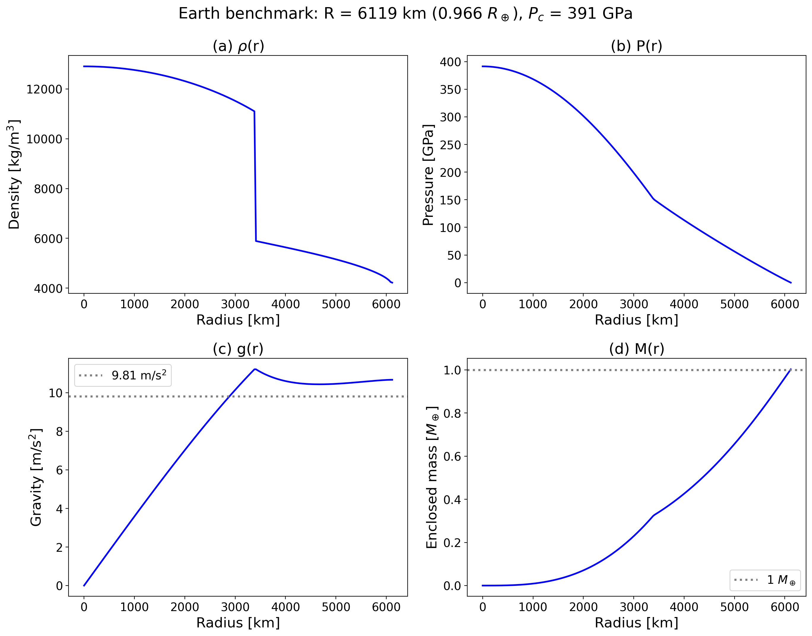
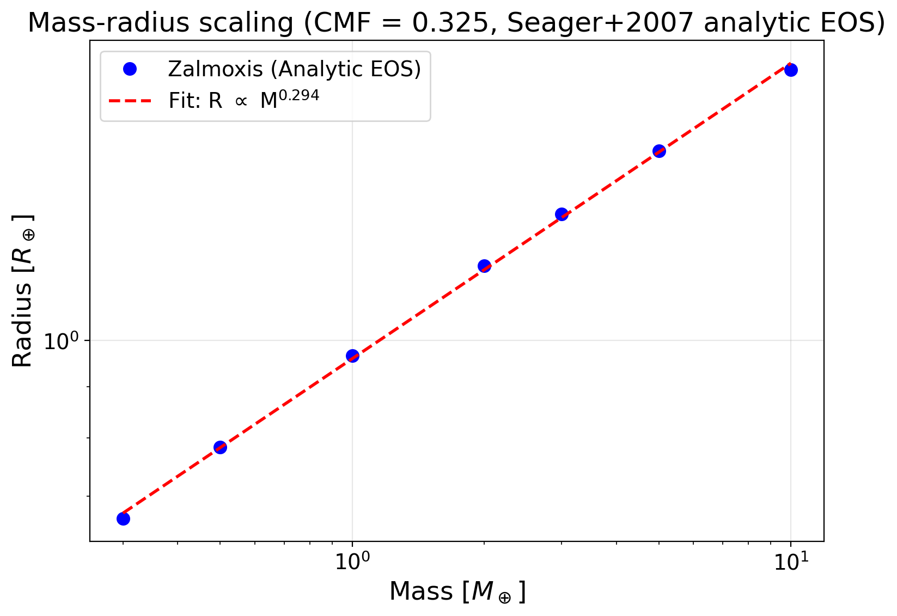
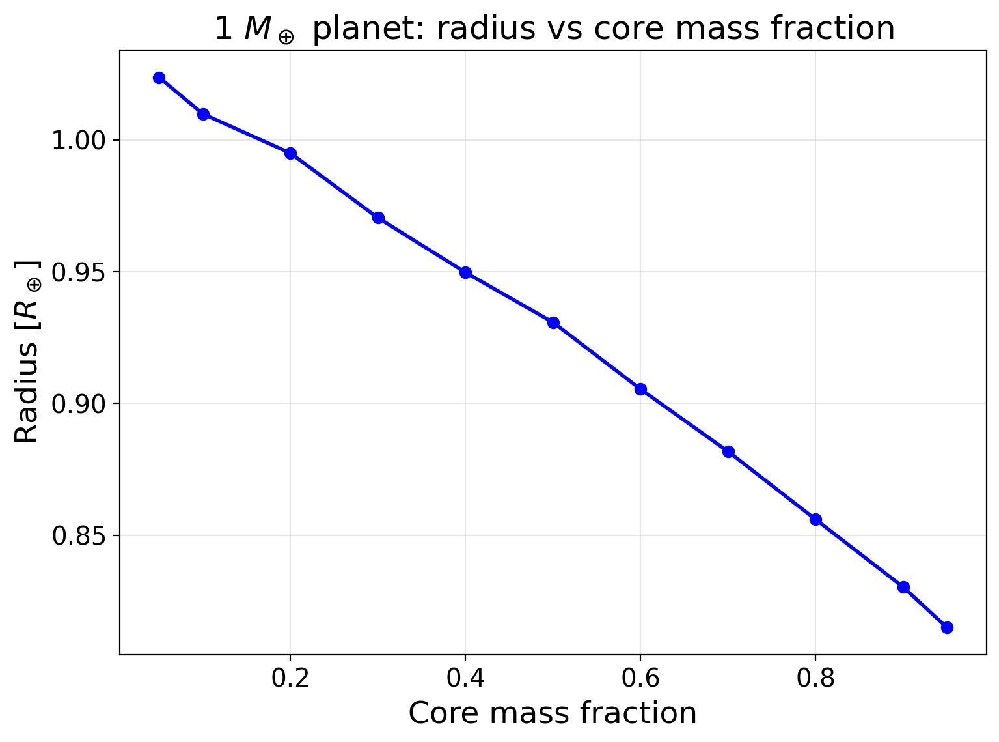

# Mass-radius relation

These cases run the full solver with the Seager et al. (2007) analytic EOS and compare the planet against Earth, published scaling laws and physical trends. The [overview](index.md) lists every case of the tab.

## Test 5: Earth benchmark

**What it tests:** The complete solver chain, including all three nested loops (mass-radius convergence, Picard density iteration, Brent central-pressure root-finding), against the best-characterized planet in the solar system.

**Setup:** $M_p = 1\, M_\oplus$, $f_c = 0.325$, Seager et al. (2007) analytic EOS (iron core, MgSiO$_3$ mantle). No tabulated data files needed. The analytic EOS uses the modified polytrope $\rho(P) = \rho_0 + c P^n$ with published coefficients.

**Results:**

| Quantity | Zalmoxis | Earth | Deviation |
|----------|----------|-------|-----------|
| Radius | 6119 km (0.966 $R_\oplus$) | 6371 km | 4% |
| Central pressure | 391 GPa | 365 GPa | 7% |
| Surface gravity | 10.3 m/s$^2$ | 9.81 m/s$^2$ | 5% |



The 4-7% deviations are expected and physically understood. The Seager modified polytrope is a temperature-independent, zero-Kelvin EOS fit to the merged Vinet/Birch-Murnaghan (low pressure) and Thomas-Fermi-Dirac (high pressure) equations of state. It does not account for thermal expansion, which makes real Earth's mantle less dense (and therefore larger) than the zero-temperature prediction. The density profile (panel a) shows the characteristic core-mantle discontinuity at ~3400 km radius, with iron densities of 8,000-13,000 kg/m$^3$ in the core and silicate densities of 4,000-5,500 kg/m$^3$ in the mantle. The gravity profile (panel c) peaks near the CMB (as expected for Earth-like planets where the dense core concentrates mass) and decreases toward the surface.

- Reference: Earth values as the test pins them: radius $1\,R_\oplus$, surface gravity 9.8 m/s$^2$, central pressure 360 GPa (the test names no source; the table above compares with 6371 km, 9.81 m/s$^2$ and 365 GPa)
- Tolerance: radius within `abs=0.05` of $1\,R_\oplus$, surface gravity within `rel=0.10` of 9.8 m/s$^2$, central pressure within `rel=0.15` of 360 GPa
- Test id: `tests/test_first_principles.py::TestEarthBenchmark`
- Command: `pytest -o "addopts=" tests/test_first_principles.py::TestEarthBenchmark`

## Test 6: Mass-radius scaling and CMF sensitivity

**What it tests:** Whether the solver produces physically correct trends across parameter space, not just a single point.

### Mass-radius relation

For rocky planets with Earth-like composition, the mass-radius relation follows an approximate power law $R \propto M^\alpha$ where $\alpha \approx 0.27$ ([Seager et al. 2007](https://iopscience.iop.org/article/10.1086/521346)). The exponent is less than $1/3$ (the value for an incompressible sphere of constant density) because larger planets have higher internal pressures that compress the material, partially offsetting the volume increase from added mass.

Running Zalmoxis from 0.3 to 10 $M_\oplus$ with $f_c = 0.325$ and fitting $\log R$ vs $\log M$ gives $\alpha = 0.294$:



The fitted exponent is slightly higher than the Seager et al. value of 0.27, which reflects the sensitivity of the power-law fit to the mass range used. Seager et al. fit over 1-10 $M_\oplus$; including sub-Earth masses (0.3 $M_\oplus$) steepens the slope because low-mass planets are less compressed, making the $R(M)$ curve slightly steeper at the low-mass end.

### CMF monotonicity

At fixed mass ($1\, M_\oplus$), increasing the core mass fraction (replacing less dense silicate with denser iron) must monotonically decrease the radius. This is a basic physical constraint: iron ($\rho_0 = 8300$ kg/m$^3$) is roughly twice as dense as MgSiO$_3$ ($\rho_0 = 4100$ kg/m$^3$), so more iron means a more compact planet.

Zalmoxis produces a strictly decreasing curve from $R \approx 1.04\, R_\oplus$ at $f_c = 0.05$ (nearly pure silicate) to $R \approx 0.77\, R_\oplus$ at $f_c = 0.95$ (nearly pure iron):



The pure iron endpoint matches the Seager et al. (2007) published value of $0.77\, R_\oplus$ for a 1 $M_\oplus$ iron planet. The curvature of the relationship (concave upward) reflects the nonlinear pressure dependence of the EOS: at high CMF, the additional iron is compressed to higher density by the larger central pressure, so the radius decrease per unit CMF increase becomes smaller.

### Conservation checks on full solver output

The integration tests also verify three conservation properties of the full solver output:

- **Mass conservation:** $M(R_\mathrm{surface}) = M_p$ to within the solver's mass-convergence tolerance, confirmed independently by trapezoidal integration of $4\pi r^2 \rho(r)$.
- **Surface pressure:** $P(R_\mathrm{surface}) = P_\mathrm{target}$ (101,325 Pa) to within the Brent solver's pressure tolerance.
- **Gauss's law:** $g = GM/r^2$ satisfied to $< 10^{-3}$ relative error at all radii in the converged solution, verifying that the Picard iteration and Brent solver do not introduce conservation violations.

- Reference: `TestMassRadiusScaling`, $\alpha \approx 0.27$ for masses 0.5, 1, 2, 5 and 10 $M_\oplus$, and `TestPureIronPlanet`, $0.77\,R_\oplus$ for CMF = 1.0, both from [Seager et al. (2007)](https://iopscience.iop.org/article/10.1086/521346); `TestCMFMonotonicity` (CMF 0.1 to 0.7) and `TestConservationLaws` check physical constraints with no published reference
- Tolerance: exponent within `abs=0.04` of 0.27; strictly decreasing radius with CMF; pure-iron radius within `abs=0.05` of $0.77\,R_\oplus$; mass within 1% (2% by trapezoidal integration); surface pressure within 2e9 Pa of the target; Gauss's law `rtol=1e-3`
- Test id: `tests/test_first_principles.py::TestMassRadiusScaling`, `tests/test_first_principles.py::TestCMFMonotonicity`, `tests/test_first_principles.py::TestPureIronPlanet`, `tests/test_first_principles.py::TestConservationLaws`
- Command: `pytest -o "addopts=" tests/test_first_principles.py::TestMassRadiusScaling tests/test_first_principles.py::TestCMFMonotonicity tests/test_first_principles.py::TestPureIronPlanet tests/test_first_principles.py::TestConservationLaws`

## Reproducing the results

The first-principles figures can be made again, as PDF files, with:

```console
python -m tools.validation.run_first_principles_validation
```

Output is saved to `output/first_principles_validation/` (PDF format). The full test suite can be run with:

```console
pytest -o "addopts=" tests/test_first_principles.py -v
```
