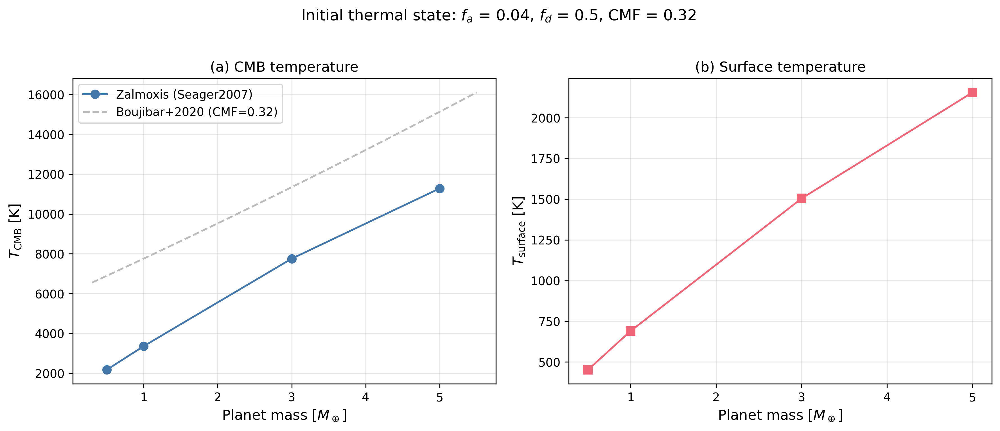
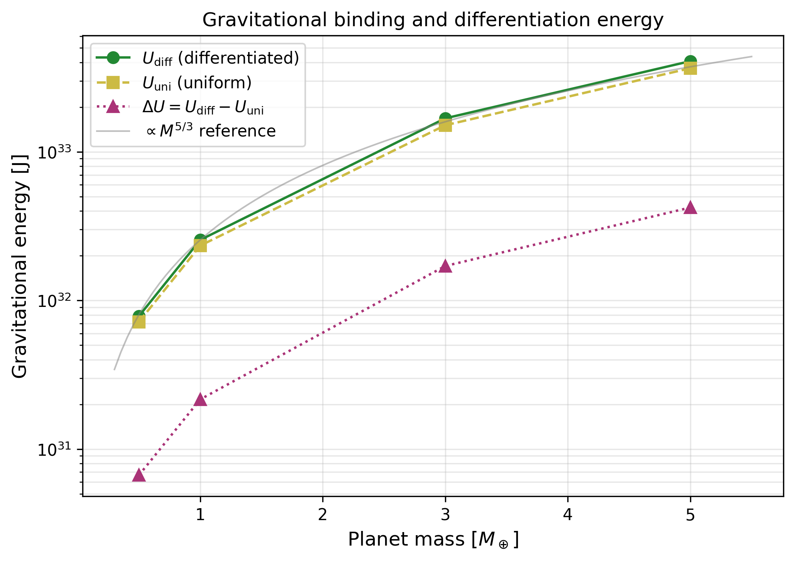
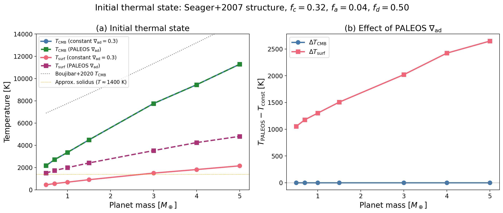
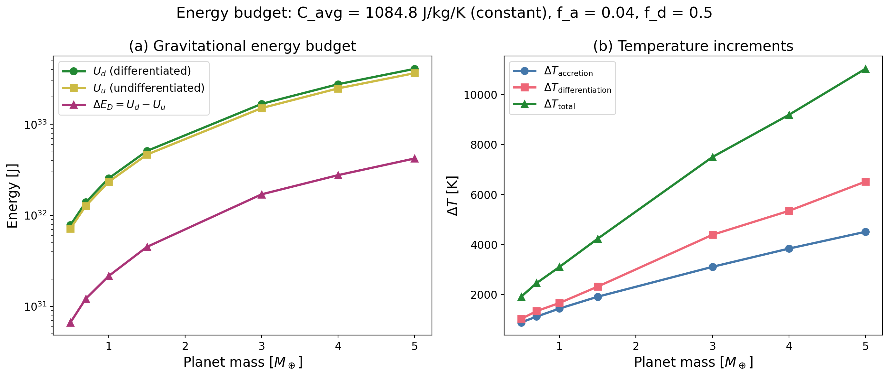

# Thermal state

These figures come from 2 scripts for the initial thermal state computation of the energetics module (`zalmoxis.energetics.initial_thermal_state`). No test asserts them and CI does not run the scripts. The text below is from the docstrings of the scripts. The [overview](index.md) lists every case of the tab.

## Mass dependence with the Seager et al. (2007) EOS

`tools/validation/validate_thermal_state.py` runs Zalmoxis with the [Seager et al. (2007)](https://iopscience.iop.org/article/10.1086/521346) analytic EOS for 5 planet masses (0.5, 1, 2, 3, 5 $M_\oplus$) and computes the initial thermal state for each.

Plot 1: (a) $T_\mathrm{CMB}$ against planet mass, with the Boujibar et al. (2020) polynomial overlay; (b) $T_\mathrm{surface}$ against planet mass.

Plot 2: $U_d$, $U_u$ and $\Delta U = U_d - U_u$ against planet mass.

- References: Seager et al. (2007); Boujibar et al. (2020) and White & Li (2025), reference named in the script docstring.
- Tolerance: none (no test).
- Test id: none; status: script figure, no test, not run in CI.
- Command: `python tools/validation/validate_thermal_state.py`. The script does not run with the current `initial_thermal_state`, which returns `T_surf_accr` and no `T_surface` key.

## Constant and PALEOS material properties

`tools/validation/validate_thermal_state_paleos.py` compares the initial thermal state from the Seager et al. (2007) EOS with PALEOS material properties. It reproduces the mass-temperature trend from White & Li (2025, Fig. 3) using:

1. Constant material properties (C_Fe=840, C_sil=1200, nabla_ad=0.3)
2. PALEOS-derived material properties (nabla_ad from unified table, C_p from table, pressure-dependent heat capacities)

The script also highlights the surface temperature issue: for 1 $M_\oplus$ planets, $T_\mathrm{surface}$ from the adiabatic integration can be well below the solidus, meaning the surface would accrete solid (not as a magma ocean).

- References: White & Li (2025) and Boujibar et al. (2020), reference named in the script docstring.
- Tolerance: none (no test).
- Test id: none; status: script figure, no test, not run in CI.
- Command: `python tools/validation/validate_thermal_state_paleos.py`. The script does not run with the current `initial_thermal_state`, which returns `T_surf_accr` and no `T_surface` key.
