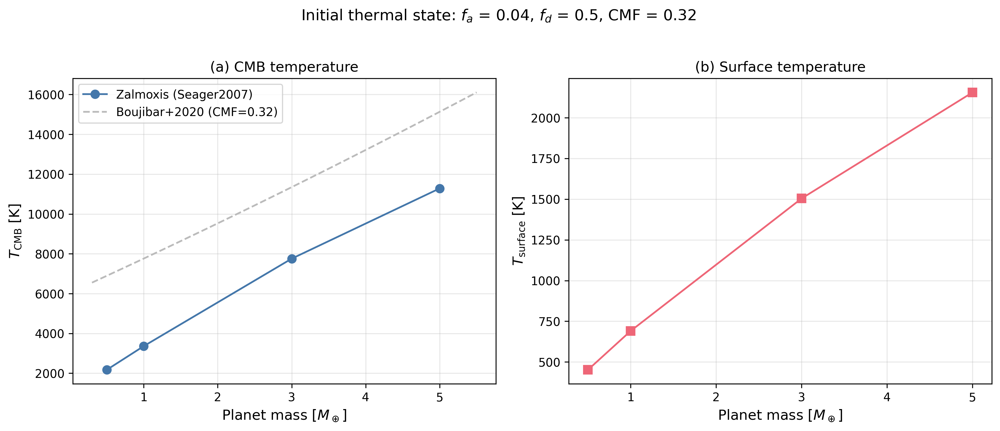
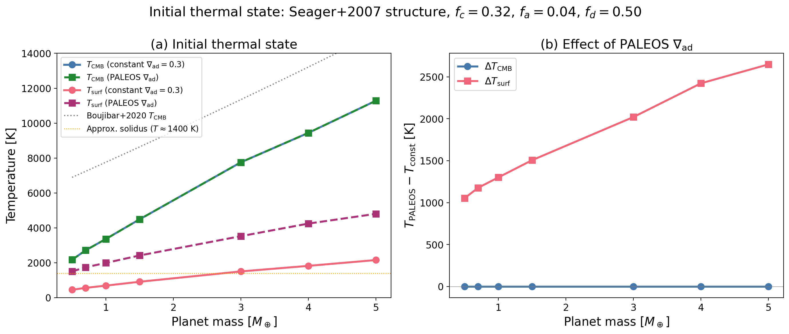
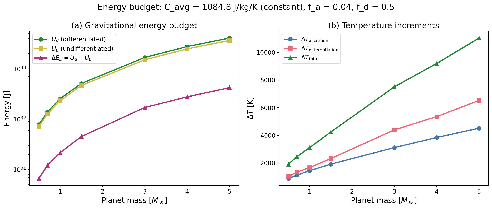

# Thermal state

## What this page checks

This page checks the temperature profile of a planet. It has 2 parts.
The first part checks how Zalmoxis integrates the adiabat, the temperature profile along which the entropy is constant. Tests run each of its 3 cases, and each case has a plot pair.
Every adiabatic structure of Zalmoxis takes its temperature from this integration, and so does the first structure solve of a PROTEUS start-up with Zalmoxis in an adiabatic temperature mode.
The second part shows how the initial thermal state depends on the planet mass and on the material properties. The initial thermal state is the temperature at the core-mantle boundary (CMB) and at the surface right after accretion, which `zalmoxis.energetics.initial_thermal_state` computes. Those figures come from scripts: no test asserts them and CI does not run the scripts.
Validation means that a test runs the code on a case with a known right answer and checks the result within a stated tolerance.
Each tested case says why the check exists, what it tests, how we know the right answer and why it matters, and ends with a box "Test details". Each script case says why the comparison exists, what it shows, how we know the right answer and why it matters, and ends with a box "Script details". The [overview](index.md) lists every case of the tab.
[How the adiabat is integrated](../Explanations/adiabat_integration.md) explains the method that the first 3 cases check.

## Adiabat integration on smooth gradients

**Why this check exists.** A wrong step formula or a sign error in the outward integration gives an error that does not fall as the square of the step size. The test fails for a first-order step, which gives an order near 1.

**What it tests.** `compute_adiabatic_temperature` runs on a stub planet: 31 nodes from 360 GPa to 2 bar, with no structure solve, and with the adiabatic gradient $\nabla_\mathrm{ad}$ given as a function. $T_a$ and $P_a$ are the temperature and the pressure at the anchor node. There are 3 cases, with $a = 0.1$ and $b = 0.05$: a constant $\nabla_\mathrm{ad} = 0.1$; $\nabla_\mathrm{ad} = a \sqrt{T_a / T}$, which depends on the temperature; and $\nabla_\mathrm{ad} = a + b \cos(\ln P)$, which depends on the pressure. Each case runs with the surface anchor and with the CMB anchor, at the substep limits $h$ = 0.04, 0.02, 0.01, 0.005 and 0.0025 in $\ln P$.

**How we know the right answer.** Each case has an exact solution: $T = T_a (P/P_a)^{0.1}$; $T = T_a \left(1 + a \ln(P/P_a)/2\right)^2$; and $\ln T = \ln T_a + a \ln(P/P_a) + b (\sin \ln P - \sin \ln P_a)$.

**Why it matters.** This integration sets the temperature of every adiabatic structure of Zalmoxis, and of the first structure solve of a PROTEUS start-up with Zalmoxis in an adiabatic temperature mode.

{ width="80%" }
{ width="80%" }

**How to read the plot.** The x axis is the substep size in $\ln P$ and the y axis the largest relative error in $T$ over the nodes; both are logarithmic. Each line is one case with one anchor, and the dotted line has slope 2. The test asserts that each line has a slope from 1.9 to 2.1 between neighbour points. The constant case is exact to round-off and is not drawn. A pass means that every line runs parallel to the dotted line.

??? info "Test details"
    - Reference: the closed-form solutions above (analytical).
    - Tolerance: order 1.9 to 2.1 between successive $h$; relative $10^{-12}$ for the constant gradient at every node.
    - Test id: `tests/test_adiabatic.py::TestMidpointAdiabat::test_midpoint_is_second_order`, `::test_constant_nabla_is_exact`.
    - Command: `pytest -o "addopts=" tests/test_adiabatic.py -k "second_order or constant_nabla"`.

## Adiabat integration on real profiles

**Why this check exists.** On the PALEOS tables $\nabla_\mathrm{ad}$ has kinks, so the order of the smooth cases does not carry over. A substep limit that is too large, or a wrong mixture for a segment, puts the temperature off by more than 1 K, and the test fails. A second test fails when a default call takes another number of substeps.

**What it tests.** It uses 6 stored structures of real solves: 4 starts of `input/default.toml` at 2515 K, with the surface anchor and a padded top, and the PROTEUS initial structure setups `all_options` and `dummy`, with the CMB anchor. On each, the temperature of a default call is compared with an independent integration at every node that the integration sets: all nodes with the surface anchor, and the CMB node outward with the CMB anchor. The second test counts the reads of $\nabla_\mathrm{ad}$ in a default call: 2 per substep, with $\lceil |\Delta \ln P| / 0.0025 \rceil$ substeps per segment.

**How we know the right answer.** The reference integrates the same equation with `scipy.integrate.solve_ivp` (the adaptive RK45 method) at a relative tolerance of $10^{-10}$, on the same nodes and with the same rules: the mixture of each segment, the 1 bar floor, the padded top and the caps. It shares no step code with Zalmoxis.

**Why it matters.** These are the temperature profiles of the default configuration and of the PROTEUS start-up.

{ width="80%" }
{ width="80%" }

**How to read the plot.** The plot shows $T$ against $P$ for default start 0. The midpoint line and the dotted reference lie on each other. The dashed line is a forward Euler step, one first-order step in $P$ per node, computed in the test from the stored structure; it also holds the padded top shell isothermal and is 473 K too cold at the centre. The grey line is the iron melting curve at core pressures. A pass means that the midpoint line lies on the dotted reference.

The largest difference from the reference on each profile, against the test bound of 1 K:

| Profile | macOS 26, arm64, Python 3.12 |
|---|---|
| default starts 0 to 3 | 0.0767, 0.9338, 0.1303, 0.2541 K |
| PROTEUS `all_options` | 0.0004 K |
| PROTEUS `dummy` | 0.0002 K |

The values depend on the platform at the level of round-off, so a plot of them cannot match on every platform; the test asserts the 1 K bound and prints the values.

**Known limit.** The test integrates on stored structures and runs no structure solve. The forward Euler line is context: the test asserts only that it is at least 5 times, and more than 2 K, farther from the reference than the midpoint.

A structure solve returns core temperatures that are not on the adiabat of its own returned structure: the solve reads the core temperature from the T(P) table built on the pass before. In 4 starts of `input/default.toml` at 2515 K whose planet masses differ by $k \times 10^{-12}$ ($k$ = 0 to 3), the returned core temperature lies up to 20.6 K above that adiabat, and the difference grows across 239 to 264 GPa, where the core adiabat crosses the boundary between liquid and solid iron. Over the mantle the difference is at most 0.41 K, at the CMB node at most 1.18 K. The centre temperatures of the adiabats of the 4 returned structures lie within 6.9 K; the slow test `tests/test_adiabat_start_spread.py` bounds them at 12 K, and it does not bound the returned core temperature.

??? info "Test details"
    - Reference: `scipy.integrate.solve_ivp` (RK45), relative tolerance $10^{-10}$, absolute $10^{-12}$; profiles in `tests/data/adiabat_profiles.npz`, written by `python -m tools.validation.adiabat_profiles write`, which checks that the stored call gives the temperature of each solve bit for bit.
    - Tolerance: 1 K at every node that the integration sets; no read of a missing or non-positive gradient; the exact read count of a default call.
    - Test id: `tests/test_adiabat_real_profiles.py::test_midpoint_adiabat_meets_the_reference_on_real_profiles`, `tests/test_adiabatic.py::TestMidpointAdiabat::test_default_call_uses_the_0p0025_substeps`.
    - Command: `pytest -o "addopts=" tests/test_adiabat_real_profiles.py -k reference_on_real_profiles`.

## Temperature across 1 bar

**Why this check exists.** If the integration skipped every segment with an end below $10^5$ Pa, the top temperature would jump when the surface pressure crosses 1 bar between passes, and with the surface anchor the whole profile would move. The test fails for any step larger than 0.01 K.

**What it tests.** The stored `dummy` structure, whose top lies near 1 atm, gets 41 top pressures from 0.9 to 1.1 bar; the test runs both anchors on each. Unit tests on a stub planet check the same rule against the exact solution for a constant gradient, for top pressures from 0.5 to 2 bar, and check that a padded top ($P = 0$) gives the profile of a top at 1 Pa and at $10^5$ Pa.

**How we know the right answer.** For a solid or a liquid, $\nabla_\mathrm{ad}$ is close to zero below 1 bar, so the true adiabat changes the temperature there by about 0.002 K ([How the adiabat is integrated](../Explanations/adiabat_integration.md#low-pressure-padded-tops-and-limits)). A correct profile therefore changes smoothly with the top pressure.

**Why it matters.** The PROTEUS `dummy` setup has a surface pressure of 1 atm. A jump at 1 bar would move its top node by about 22 K between passes and between starts that differ only by round-off.

{ width="80%" }
{ width="80%" }

**How to read the plot.** The x axis is the top pressure in bar, and the y axis the top node temperature minus its value at 1.1 bar, with the CMB anchor. The dashed line is a step that is skipped below 1 bar, computed in the test: it jumps by about 22 K at 1 bar. The solid line is the midpoint integration with the 1 bar floor and stays flat. The test asserts that no node of the solid profile changes by more than 0.01 K between neighbour points, and that the dashed line jumps by more than 10 K. A pass means a flat solid line.

??? info "Test details"
    - Reference: continuity in the top pressure; the exact solution $T = T_a (P'/P'_a)^{0.1}$ with $P' = \max(P, 10^5\,\mathrm{Pa})$ for the stub planet.
    - Tolerance: 0.01 K between neighbour top pressures at every node; relative $10^{-12}$ for the stub planet; exact equality for the padded top.
    - Test id: `tests/test_adiabat_real_profiles.py::test_temperature_is_continuous_across_one_bar`, `tests/test_adiabatic.py::TestMidpointAdiabat::test_low_pressure_rule_follows_the_floored_adiabat`, `::test_padded_top_integrates_like_the_floor`.
    - Command: `pytest -o "addopts=" tests/test_adiabat_real_profiles.py tests/test_adiabatic.py -k "one_bar or floored_adiabat or padded_top"`.

## Mass dependence with the Seager et al. (2007) EOS

**Why this comparison exists.** The initial temperatures depend on the planet mass through the gravitational energy released in accretion; the figures show that dependence.

**What it shows.** `tools/validation/validate_thermal_state.py` runs Zalmoxis with the Seager et al. (2007)[^cite-seager2007] analytic EOS for 5 planet masses (0.5, 1, 2, 3, 5 $M_\oplus$) and computes the initial thermal state for each.

Plot 1: (a) $T_\mathrm{CMB}$, the temperature at the CMB, against planet mass, with the Boujibar et al. (2020)[^cite-boujibar2020] polynomial overlay; (b) $T_\mathrm{surface}$, the surface temperature, against planet mass.

Plot 2: $U_d$, $U_u$ and $\Delta U = U_d - U_u$ against planet mass. $U_d$ is the gravitational binding energy of the differentiated planet from its density profile, and $U_u = 3GM^2/5R$ that of an undifferentiated sphere of the same mass $M$ and radius $R$.

**How we know the right answer.** Plot 1 overlays the polynomial of Boujibar et al. (2020) on the CMB temperature.

**Why it matters.** The initial thermal state sets the start temperatures of the interior.

**Known limit.** The figures come from a script; no test asserts them, and the script does not run with the current `initial_thermal_state`.

??? info "Script details"
    - References: Seager et al. (2007); Boujibar et al. (2020) and White & Li (2025), reference named in the script docstring.
    - Tolerance: none (no test).
    - Test id: none; status: script figure, no test, not run in CI.
    - Command: `python tools/validation/validate_thermal_state.py`. The script does not run with the current `initial_thermal_state`, which returns `T_surf_accr` and no `T_surface` key.

## Constant and PALEOS material properties

**Why this comparison exists.** Constant material properties and PALEOS properties give different initial temperatures; the comparison shows how large that difference is.

**What it shows.** `tools/validation/validate_thermal_state_paleos.py` compares the initial thermal state from the Seager et al. (2007) EOS with PALEOS material properties. It reproduces the mass-temperature trend from White & Li (2025, Fig. 3)[^cite-whiteli2025] using:

1. The Seager et al. (2007) structure with the default material properties of `initial_thermal_state`: heat capacities of 450 J/kg/K for iron and 1250 J/kg/K for silicate. The temperature follows the Gruneisen adiabat, an adiabat set by the Gruneisen parameter $\gamma$ = 1.3. The script docstring names other constants (C_Fe=840, C_sil=1200, nabla_ad=0.3), but the script does not pass them to `initial_thermal_state`.
2. The same structure with the adiabatic gradient `nabla_ad` from the PALEOS unified table and the default heat capacities. A step falls back to the Gruneisen step where the PALEOS change exceeds it by more than 50 %. The script defines a PALEOS heat-capacity function (`build_paleos_cp`) but does not call it.

The script also highlights the surface temperature issue: for 1 $M_\oplus$ planets, $T_\mathrm{surface}$ from the adiabatic integration can be well below the solidus, meaning the surface would accrete solid (not as a magma ocean).

**How we know the right answer.** The script compares with the trend of White & Li (2025, Fig. 3) in style only, and overlays the Boujibar et al. (2020) polynomial; it plots no White & Li numbers.

**Why it matters.** It shows which material properties the initial thermal state needs.

**Known limit.** The figures come from a script; no test asserts them, and the script does not run with the current `initial_thermal_state`.

??? info "Script details"
    - References: White & Li (2025) and Boujibar et al. (2020), reference named in the script docstring.
    - Tolerance: none (no test).
    - Test id: none; status: script figure, no test, not run in CI.
    - Command: `python tools/validation/validate_thermal_state_paleos.py`. The script does not run with the current `initial_thermal_state`, which returns `T_surf_accr` and no `T_surface` key.

## Three levels of material properties

**Why this comparison exists.** The structure and the material properties can each come from the simple or the PALEOS model; the comparison separates their effects.

**What it shows.** `tools/validation/validate_thermal_state_full_paleos.py` compares 3 levels: the Seager et al. (2007) structure with constant properties, the same structure with the PALEOS adiabatic gradient, and the PALEOS structure with PALEOS properties at the CMB. It also sweeps the accretion heat retention efficiency $f_a$ from 0.01 to 0.40 for the full PALEOS case. It writes `thermal_state_three_tiers`, `thermal_state_fa_full_paleos` and `thermal_state_whiteli_comparison`; this page shows none of them.

**How we know the right answer.** The Boujibar et al. (2020) polynomial, and a run with the accretion efficiency of White & Li (2025), $f_a$ = 0.04 (with the differentiation efficiency $f_d$ = 0.50). The script also runs a case with the parameters of Boujibar et al. (2020): $f_a$ = $f_d$ = 0.40, with heat capacities of 840 and 1200 J/kg/K.

**Why it matters.** The script writes the effect of the accretion heat retention $f_a$ on the start temperatures to `thermal_state_fa_full_paleos`, which this page does not show.

**Known limit.** The results come from a script; no test asserts them, the page shows none of the figures, and the script does not run with the current `initial_thermal_state`.

??? info "Script details"
    - References: Boujibar et al. (2020) polynomial; White & Li (2025), accretion efficiency $f_a$ = 0.04.
    - Tolerance: none (no test).
    - Test id: none; status: script figure, no test, not run in CI.
    - Command: `python tools/validation/validate_thermal_state_full_paleos.py`. Like the 2 scripts above, it reads the `T_surface` key, which the current `initial_thermal_state` does not return.

## References

[^cite-boujibar2020]: A. Boujibar, P. Driscoll, Y. Fei, *[Super-Earth internal structures and initial thermal states](https://doi.org/10.1029/2019JE006124)*, Journal of Geophysical Research: Planets, 125, e2019JE006124, 2020. [SciX](https://scixplorer.org/abs/2020JGRE..12506124B/abstract).

[^cite-seager2007]: S. Seager, M. Kuchner, C. A. Hier-Majumder, B. Militzer, *[Mass-radius relationships for solid exoplanets](https://doi.org/10.1086/521346)*, The Astrophysical Journal, 669, 1279-1297, 2007. [SciX](https://scixplorer.org/abs/2007ApJ...669.1279S/abstract).

[^cite-whiteli2025]: N. I. White, J. Li, *[Initial thermal states of super-Earth exoplanets and implications for early dynamos](https://doi.org/10.1029/2024JE008550)*, Journal of Geophysical Research: Planets, 130, e2024JE008550, 2025. [SciX](https://scixplorer.org/abs/2025JGRE..13008550W/abstract).
