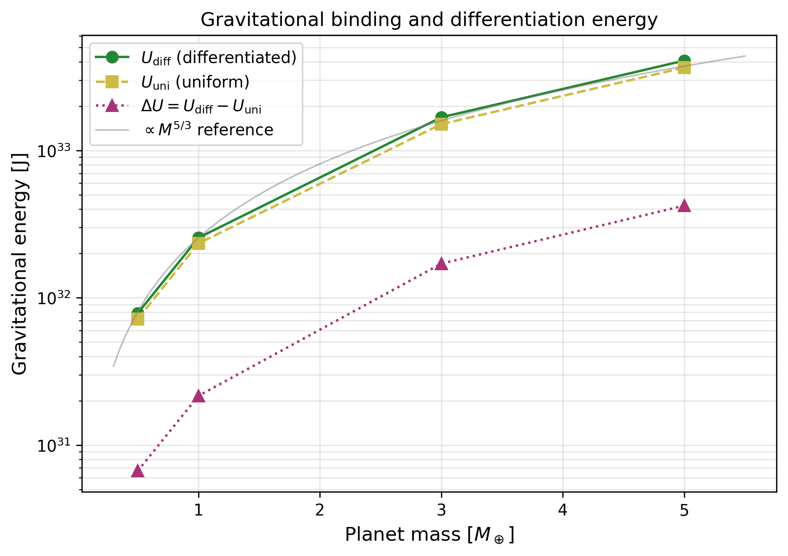

# Thermal state

## What this page checks

This page checks the temperature profile of a planet. Validation means that a test runs the code on a case with a known right answer and checks the result within a stated tolerance. The page has 2 parts:

- **Adiabat integration (6 tested cases).** Zalmoxis integrates the adiabat, the temperature profile along which the entropy is constant. Every adiabatic structure of Zalmoxis takes its temperature from this integration, and so does the first structure solve of a PROTEUS start-up with Zalmoxis in an adiabatic temperature mode. A test runs each case, and each case has a plot pair. [How the adiabat is integrated](../Explanations/adiabat_integration.md) explains the method.
- **Initial thermal state (3 script cases).** The temperature at the core-mantle boundary (CMB) and at the surface right after accretion, which `zalmoxis.energetics.initial_thermal_state` computes, as a function of the planet mass and the material properties. These figures come from scripts: no test asserts them and CI does not run the scripts.

Each tested case says why the check exists, what it tests, how we know the right answer and why it matters, and ends with a box "Test details". Each script case has the same parts for a comparison and ends with a box "Script details". The [overview](index.md) lists every case of the tab.

## Adiabat integration on smooth gradients

**Why this check exists.** A wrong step formula or a sign error in the outward integration gives an error that does not fall as the square of the step size. The test fails for a first-order step, which gives an order near 1.

**What it tests.** `compute_adiabatic_temperature` runs on a stub planet: 31 nodes from 360 GPa to 2 bar, with no structure solve, and with the adiabatic gradient $\nabla_\mathrm{ad}$ given as a function. $T_a$ and $P_a$ are the temperature and the pressure at the anchor node. There are 3 cases, with $a = 0.1$ and $b = 0.05$: a constant $\nabla_\mathrm{ad} = 0.1$; $\nabla_\mathrm{ad} = a \sqrt{T_a / T}$, which depends on the temperature; and $\nabla_\mathrm{ad} = a + b \cos(\ln P)$, which depends on the pressure. Each case runs with the surface anchor and with the CMB anchor, at the substep limits $h$ = 0.04, 0.02, 0.01, 0.005 and 0.0025 in $\ln P$.

**How we know the right answer.** Each case has an exact solution: $T = T_a (P/P_a)^{0.1}$; $T = T_a \left(1 + a \ln(P/P_a)/2\right)^2$; and $\ln T = \ln T_a + a \ln(P/P_a) + b (\sin \ln P - \sin \ln P_a)$.

**Why it matters.** This integration sets the temperature of every adiabatic structure of Zalmoxis, and of the first structure solve of a PROTEUS start-up with Zalmoxis in an adiabatic temperature mode.

{ width="80%" }
{ width="80%" }

**How to read the plot.** The x axis is the substep size in $\ln P$ and the y axis the largest relative error in $T$ over the nodes; both are logarithmic. Each line is one case with one anchor, and the dotted line has slope 2. The test asserts that each line has a slope from 1.9 to 2.1 between neighbour points. The constant case is exact to round-off and is not drawn. A pass means that every line runs parallel to the dotted line.

??? info "Test details"
    - Reference: the closed-form solutions above (analytical).
    - Tolerance: order 1.9 to 2.1 between successive $h$; relative $10^{-12}$ for the constant gradient at every node.
    - Test id: `tests/test_adiabatic.py::TestMidpointAdiabat::test_midpoint_is_second_order`, `::test_constant_nabla_is_exact`.
    - Command: `pytest -o "addopts=" tests/test_adiabatic.py -k "second_order or constant_nabla"`.

## Adiabat integration on real profiles

**Why this check exists.** On the PALEOS tables $\nabla_\mathrm{ad}$ has kinks, so the order of the smooth cases does not carry over. A substep limit that is too large, or a wrong mixture for a segment, puts the temperature off by more than 1 K, and the test fails. A second test fails when a default call takes another number of substeps.

**What it tests.** It uses 6 stored structures of real solves: 4 starts of `input/default.toml` at 2515 K, with the surface anchor and a padded top, and the PROTEUS initial structure setups `all_options` and `dummy`, with the CMB anchor. On each, the temperature of a default call is compared with an independent integration at every node that the integration sets: all nodes with the surface anchor, and the CMB node outward with the CMB anchor. The second test counts the reads of $\nabla_\mathrm{ad}$ in a default call: 2 per substep, with $\lceil |\Delta \ln P| / 0.0025 \rceil$ substeps per segment.

**How we know the right answer.** The reference integrates the same equation with `scipy.integrate.solve_ivp` (the adaptive DOP853 method) at a relative tolerance of $10^{-13}$, on the same nodes and with the same rules: the mixture of each segment, the cut of a segment at the CMB (the stored profiles hold no inner core; the unit tests of the cut check the ICB), the 1 bar floor, the padded top and the caps. It shares no step code with Zalmoxis, and the test checks it against a second integration, RK45 at the same tolerance, to 0.01 K.

**Why it matters.** These are the temperature profiles of the default configuration and of the PROTEUS start-up.

{ width="80%" }
{ width="80%" }

**How to read the plot.** The plot shows $T$ in K against $P$ for default start 0. The test asserts that the midpoint line lies within 1 K of the dotted DOP853 reference at every node; at this scale the 2 lines lie on each other. The dashed line is a forward Euler step: one first-order step in $P$ per node, from `forward_euler` in `tools/validation/adiabat_profiles.py`, with the padded top shell held isothermal. The test asserts only that it lies at least 5 times, and more than 2 K, farther from the reference than the midpoint line; at the centre it lies 402 K below. The grey line is context: the iron melting curve of Anzellini et al. (2013)[^cite-anzellini2013] at core pressures (`zalmoxis.melting_curves.iron_melting_anzellini13`). A pass means that the midpoint line lies on the dotted reference.

The largest difference from the reference on each profile, against the test bound of 1 K:

| Profile | macOS 26, arm64, Python 3.12 |
|---|---|
| default starts 0 to 3 | 0.2536, 0.0362, 0.1795, 0.1678 K |
| PROTEUS `all_options` | below 0.0001 K |
| PROTEUS `dummy` | below 0.0001 K |

The values depend on the platform at the level of round-off, so a plot of them cannot match on every platform; the test asserts the 1 K bound and prints the values.

**Known limit.**

- **What the test covers.** The test integrates on 6 stored structures and runs no structure solve. Their structure solves used a forward Euler adiabat, so they differ a little from the structures that a solve with the midpoint adiabat returns. The Test details box names the source commit.
- **The Euler line.** It differs from the reference by its first-order step error and by its isothermal top shell, and is a visual comparison only. Where the core meets the iron melting curve, the integration itself departs from a core at constant entropy ([known limits](../Explanations/adiabat_integration.md#known-limits-of-the-integration)).

??? info "Test details"
    - Reference: `scipy.integrate.solve_ivp` (DOP853), relative tolerance $10^{-13}$, absolute $10^{-15}$, checked against RK45 at the same tolerances to 0.01 K.
    - Profiles: `tests/data/adiabat_profiles.npz`, written by `python -m tools.validation.adiabat_profiles write` at the commit in its `meta['_source']['commit']` (a JSON string in the `meta` array). The write checks that the stored call gives the temperature of each solve bit for bit, and stores the result of `forward_euler` (same module) as `T_euler`.
    - Euler line: the test compares `forward_euler` with `T_euler`.
    - Tolerance: 1 K at every node that the integration sets; no read of a missing or non-positive gradient; the exact read count of a default call.
    - Test id: `tests/test_adiabat_real_profiles.py::test_midpoint_adiabat_meets_the_reference_on_real_profiles`, `tests/test_adiabatic.py::TestMidpointAdiabat::test_default_call_uses_the_0p0025_substeps`.
    - Command: `pytest -o "addopts=" tests/test_adiabat_real_profiles.py -k reference_on_real_profiles`.

## Temperature across 1 bar

**Why this check exists.** If the integration skipped every segment with an end below $10^5$ Pa, the top temperature would jump when the surface pressure crosses 1 bar between passes, and with the surface anchor the whole profile would move. The test fails for any step larger than 0.01 K.

**What it tests.** The stored `dummy` structure, whose top lies near 1 atm, gets 41 top pressures from 0.9 to 1.1 bar; the test runs both anchors on each. Unit tests on a stub planet check the same rule against the exact solution for a constant gradient, for top pressures from 0.5 to 2 bar, and check that a padded top ($P = 0$) gives the profile of a top at 1 Pa and at $10^5$ Pa.

**How we know the right answer.** For a solid or a liquid, $\nabla_\mathrm{ad}$ is close to zero below 1 bar, so the true adiabat changes the temperature there by about 0.002 K ([How the adiabat is integrated](../Explanations/adiabat_integration.md#low-pressure-padded-tops-missing-gradients-and-caps)). A correct profile therefore changes smoothly with the top pressure.

**Why it matters.** The PROTEUS `dummy` setup has a surface pressure of 1 atm. A jump at 1 bar would move its top node by about 22 K between passes and between starts that differ only by round-off.

{ width="80%" }
{ width="80%" }

**How to read the plot.** The x axis is the top pressure in bar, and the y axis the top node temperature minus its value at 1.1 bar, with the CMB anchor. The dashed line is a step that is skipped below 1 bar, computed in the test: it jumps by about 22 K at 1 bar. The solid line is the midpoint integration with the 1 bar floor and stays flat. The test asserts that no node of the solid profile changes by more than 0.01 K between neighbour points, and that the dashed line jumps by more than 10 K. A pass means a flat solid line.

??? info "Test details"
    - Reference: continuity in the top pressure; the exact solution $T = T_a (P'/P'_a)^{0.1}$ with $P' = \max(P, 10^5\,\mathrm{Pa})$ for the stub planet.
    - Tolerance: 0.01 K between neighbour top pressures at every node; relative $10^{-12}$ for the stub planet; exact equality for the padded top.
    - Test id: `tests/test_adiabat_real_profiles.py::test_temperature_is_continuous_across_one_bar`, `tests/test_adiabatic.py::TestMidpointAdiabat::test_low_pressure_rule_follows_the_floored_adiabat`, `::test_padded_top_integrates_like_the_floor`.
    - Command: `pytest -o "addopts=" tests/test_adiabat_real_profiles.py tests/test_adiabatic.py -k "one_bar or floored_adiabat or padded_top"`.

## Temperature lookup over the top cell

**Why this check exists.** Without the shell, the temperature table holds only the 2 ends of the top cell. The lookup then follows a straight line in $\log_{10} P$, 9 to 28 K off the adiabat on these profiles (the 28 K with the top node of the default start set near 1 bar), and a solve that pads or not by round-off reads different temperatures above 1 bar. The tests fail when the lookup leaves the adiabat by more than 0.3 K, or moves with the padding of the top; the layer-boundary test fails when the shell takes the mixture of another layer than the adiabat of the solve, so that it misses the temperature of the next node.

**What it tests.** The density solve reads the temperature from a table of the adiabat against $\log_{10} P$, built on the nodes of the pass before. The top cell, from the top of the planet to the next node, spans 2 to 4 decades in pressure with no node inside, so the table gets the shell there: 64 pressures with the adiabat over the cell ([How the density solve reads the temperature over the top cell](../Explanations/adiabat_integration.md#how-the-density-solve-reads-the-temperature-over-the-top-cell)). Each test builds the table as the solve does, on stored structures, and reads it over the top cell:

- **Unpadded tops.** The 2 PROTEUS profiles, with their own tops at $1.2 \times 10^5$ and $5 \times 10^6$ Pa, and default start 0 with its top node set to $1.2 \times 10^5$ and $9.09 \times 10^4$ Pa.
- **Padded or not.** Default start 0 (surface anchor) and the 2 PROTEUS profiles (CMB anchor), each with its top node set to $P = 0$ (padded), 1 Pa, $10^5$ Pa and 1 atm; the test compares the lookups above 1 bar.
- **Layer boundary in the top cell.** A water layer from the middle of the top cell outward, with the EOS `Seager2007:H2O` (no temperature dependence) or `PALEOS:H2O`: on an unpadded top with the surface anchor, and on a padded and an unpadded top with the CMB anchor. The test also checks that the shell at the mass of the other node of the cell misses the next node by more than 1 K.
- **Unit tests and a smoke test.** They check where the shell starts and ends, which node gives the shell its mixture, and that the solve passes the right masses and direction to the table. The Test details box lists them.

**How we know the right answer.** The test integrates $d \ln T / d \ln P = \nabla_\mathrm{ad}$ again with an independent solver (`scipy.integrate.solve_ivp`, DOP853), from the top temperature over the cell. It uses the layer of the node whose mixture the adiabat of the solve takes over the cell; the test finds that node with its own copy of the anchor rule. A layer without a T-dependent EOS, such as `Seager2007:H2O`, has no adiabatic gradient, so there the adiabat holds $T$. For a top below 1 bar the adiabat holds $T$ constant there, so the padded table and the tables of tops at 1 Pa and 1 bar must agree to round-off. Where a layer boundary lies inside the cell, the shell integrated on to the next node must give the temperature of that node, which the adiabat of the solve integrates over the same cell.

**Why it matters.** The top-cell temperature enters the density of the outer mantle where the EOS table covers it. On the stored PROTEUS solves its effect on the structure is small: the shell moves the CMB pressure of the initial-structure solves by at most $4.5 \times 10^{-6}$ (relative) and the radius of the grid start-up solves on the numpy path by at most $2 \times 10^{-8}$.

{ width="80%" }
{ width="80%" }

**How to read the plot.** The x-axis is the pressure in Pa over the top cell of the PROTEUS `dummy` profile, and the y-axis the temperature in K. The solid line is the lookup of the solve and the dotted line the independent integration; the test asserts that they lie at most 0.3 K apart, and they lie on each other. The dashed straight line in $\log_{10} P$ between the ends of the cell is context: the lookup without the shell, up to 14 K off here. A pass means that the solid and dotted lines meet. The test makes this plot only with `--validation-plots`.

Measured values:

| Case | Quantity | Measured | Test bound |
|---|---|---|---|
| `dummy`, `all_options` | lookup from the independent integration | 0.047 K, 0.014 K | 0.3 K |
| default start 0, top at $1.2 \times 10^5$ / $9.09 \times 10^4$ Pa | lookup from the independent integration | 0.080 K, 0.083 K | 0.3 K |
| the 6 stored profiles, as stored and padded | shell end from the next node | at most $4 \times 10^{-7}$ K | $10^{-5}$ K (unpadded cases above) |
| water layer, `Seager2007:H2O`, or `PALEOS:H2O` with the surface anchor | shell end from the next node | $2 \times 10^{-7}$ K | $10^{-5}$ K |
| water layer, `PALEOS:H2O`, CMB anchor | shell end from the next node; lookup | $1.25 \times 10^{-5}$ K; 0.36 K ($T$ changes by about 3200 K over the cell) | $10^{-4}$ K; 0.5 K |
| tops at $P = 0$, 1 Pa, $10^5$ Pa / 1 atm, default start 0 | lookup above 1 bar from the padded one | 0 / $1.6 \times 10^{-3}$ K | $10^{-9}$ K / 0.01 K |
| the same, `dummy` and `all_options` | lookup above 1 bar from the padded one | 0 / $8.1 \times 10^{-4}$ K and $7.1 \times 10^{-4}$ K | $10^{-9}$ K / 0.01 K |

Measured once and not asserted: with a padded top, against a table with 4096 shell points, the largest difference of the lookup is about 0.08 K on `input/default.toml` at 2515 K and 0.1 K with a 3871 K WolfBower surface; the shell takes 0.53 to 0.68 % of the run time of a PROTEUS initial-structure solve.

**Known limits.**

- **JAX path.** On the JAX path the shell moves only the returned top-node temperature of the grid start-up solves, by up to 1.4 K; their structure stays the same bit for bit. The reason is the table: their top cells lie near 5640 K, and from $1.2 \times 10^5$ to $10^9$ Pa the PALEOS MgSiO$_3$ table gives the same density at 5000 K and above. It sets a temperature above its upper limit at that pressure to that limit (4882 K at $1.2 \times 10^5$ Pa).
- **The cell below a padded top cell.** With a padded top, the shell covers the cell from 1 bar to the outermost node with a positive pressure only. The next cell, from that node to the node below it, stays a straight line in $\log_{10} P$ as every cell between 2 nodes does, and it is the widest of them near the top. On the 4 padded default starts it spans 1.08 to 1.16 GPa to 2.30 to 2.38 GPa, and the lookup there lies at most 2.74, 2.92, 2.80 and 2.75 K from an independent integration from the temperature of the outermost node with a positive pressure. This is in every padded solve of `input/default.toml`; the tests on this page do not bound it.

??? info "Test details"
    - Reference: `scipy.integrate.solve_ivp` (DOP853), relative tolerance $10^{-12}$ and absolute tolerance $10^{-14}$ on $\ln T$, in the layer of the node whose mixture the adiabat of the solve takes over the cell, from the top temperature; the padded table for the tops at 1 Pa, $10^5$ Pa and 1 atm; the temperature of the next node with the water layer.
    - Tolerance: 0.3 K over the top cell; the shell end to $10^{-5}$ K of the next node, also with the water layer except `PALEOS:H2O` with the CMB anchor ($10^{-4}$ K), where the shell at the other node must miss by more than 1 K and the lookup must lie within 0.5 K; $10^{-9}$ K for the tops at 1 Pa and $10^5$ Pa and 0.01 K for the top at 1 atm against the padded top.
    - Test ids: `tests/test_adiabat_real_profiles.py::test_the_lookup_follows_the_adiabat_over_an_unpadded_top_cell`, `::test_the_top_cell_lookup_does_not_flip_with_the_padding`, `::test_the_top_cell_shell_meets_the_next_node_across_a_layer_boundary`; `tests/test_adiabatic.py::TestAdiabatTable` (unit tier, among them `::test_an_unpadded_top_cell_gains_the_shell`, `::test_an_unpadded_top_at_or_near_the_floor`, `::test_the_shell_takes_the_mass_of_the_node_of_the_adiabat_over_the_cell`, `::test_table_property_over_profiles` and `::test_a_padded_top_keeps_the_table_of_the_padded_rule`); `tests/test_accepted_on.py::test_the_solve_gives_the_table_the_masses_and_the_direction_of_its_adiabat` (smoke).
    - Unit-test checks: where the shell starts and ends, also at 1 bar, within $10^{-9}$ of it and 1 ULP (unit in the last place, the smallest step between 2 floating-point numbers) below it; the node whose mass the shell takes for each anchor, and that the table stays inside the node array on pressures out of node order (a guard; a solve gives pressures that fall outward); and that the table of a padded top with the surface anchor is, bit for bit, the nodes plus the shell from 1 bar. With the CMB anchor the padded shell takes the mass of the padded node; the table is the same when the 2 nodes of the top cell lie in one layer, as on both PROTEUS profiles. A smoke test checks that the solve gives the table the enclosed masses and the direction of its adiabat.
    - Command: `pytest -o "addopts=" tests/test_adiabat_real_profiles.py -k "top_cell"`; add `--validation-plots` to write the plot.

## Temperature at the CMB and the centre

**Why this check exists.** The density solve of a pass reads its temperature from the T(P) table of the pass before, and the CMB of that pass lies at another pressure. If the lookup ignored the layer of a node, a mantle node just above the CMB could read the core part of the table, and the core adiabat would start from the wrong temperature. If the table ended at its own central pressure, the centre nodes of a pass with a higher central pressure would all take the end value of the table. The test fails when a returned structure leaves its own adiabat near the CMB or at the centre.

**What it tests.** It runs 4 full solves: the 10 $M_\oplus$ planet of `tests/data/bench_performance.toml` with 3000 K at the surface, at 3 planet masses that differ by $k \times 10^{-12}$ of the value ($k$ = 0 to 2), and the 1 $M_\oplus$ planet of `input/default.toml`. On each returned structure it integrates $\mathrm{d} \ln T / \mathrm{d} \ln P = \nabla_\mathrm{ad}$ with an independent integrator and the same EOS tables, in 3 chains:

- the mantle from $10^{11}$ Pa, at the returned temperature there, to the first mantle node above the CMB;
- the mantle on to the CMB pressure, then the core to the top core node;
- the core from the returned top core node to the centre.

The returned temperature may differ by at most 1.5 K from the first chain, 4 K from the second and 0.5 K from the third, and the 3 innermost nodes must not share one temperature.

**How we know the right answer.** Each chain is the adiabat of the returned structure itself, integrated by `scipy.integrate.solve_ivp` with DOP853 at a relative tolerance of $10^{-12}$ and an absolute tolerance of $10^{-14}$ on $\ln T$; the second chain changes from the mantle to the core mixture exactly at the CMB pressure, with $\ln P$ linear in the enclosed mass between the 2 nodes around the CMB. At a relative tolerance of $10^{-10}$ DOP853 steps over the kink of $\nabla_\mathrm{ad}$ where the adiabat meets the melting curve of the iron table: on a 2515 K default core it then misses the converged answer by 0.7 K. This is a cross-code check of the adiabat, not an external reference.

**Why it matters.** The CMB temperature and the centre temperature of a structure start the thermal evolution of the core in a coupled model.

{ width="80%" }
{ width="80%" }

**How to read the plot.** The x-axis is the pressure in GPa and the y-axis $\Delta T$, the returned temperature minus the DOP853 chain, in K, for the 10 $M_\oplus$ planet at $k$ = 0. The mantle line compares the mantle nodes below $10^{11}$ Pa with the first chain, and the core line compares the core nodes with the third chain. The filled circle, the filled square and the open diamond are the 3 nodes that the test bounds: the first mantle node (1.5 K), the top core node against the second chain through the CMB (4 K) and the centre (0.5 K). The dotted line marks the CMB pressure. A pass means that no marked point exceeds its bound in any of the 4 solves. In the 4 solves the largest differences are 0.55 K at the first mantle node, 1.60 K at the top core node and 0.07 K at the centre (macOS arm64).

??? info "Test details"
    - Reference: DOP853 integrations of $\nabla_\mathrm{ad}$ on the returned structure (cross-code check).
    - Tolerance: 1.5 K at the first mantle node, 4 K at the top core node, 0.5 K at the centre; the 3 innermost nodes differ in temperature.
    - Test id: `tests/test_adiabat_centre.py::test_the_adiabat_meets_independent_integrations_at_the_cmb_and_the_centre` (markers `integration`, `physics_invariant` and `reference_pinned`; nightly job `main`).
    - Command: `pytest -o "addopts=" tests/test_adiabat_centre.py -s`; add `--validation-plots` to write the plot.

## Centre temperature over round-off starts

**Why this check exists.** If the temperature of a solve depended on round-off, 2 runs of the same planet would give different centre temperatures. The test fails when 4 starts that differ only by round-off end in different padding states, or when the centre temperatures of their adiabats spread by more than 12 K.

**What it tests.** It runs 4 full solves of `input/default.toml` at 2515 K, with a mass tolerance of $10^{-3}$. Their planet masses differ by $k \times 10^{-12}$ of the value ($k$ = 0 to 3). Each solve must be accepted on the full adiabat (blend 1), within the mass tolerance, not on the wall clock, and without the retry with tighter parameters. All 4 must end in the same padding state. The test then integrates the adiabat again on each returned structure and compares the 4 centre temperatures.

**How we know the right answer.** The 4 planets differ only at the level of round-off, so a correct solve gives nearly the same centre temperature for each. This is a check of reproducibility, not an external reference.

**Why it matters.** The centre temperature of the default configuration sets the core temperature that a model run starts from, and it must not depend on round-off in the planet mass.

{ width="80%" }
{ width="80%" }

**How to read the plot.** The x-axis is the start $k$ and the y-axis the centre temperature in K. The filled circles are the centre temperatures of the adiabats of the 4 returned structures, which the test asserts: their spread must fit inside the shaded 12 K band, drawn from the lowest of them. The open squares are the returned core temperatures, read from the T(P) table of the pass before; they are context and not bounded. A pass means that the 4 circles lie inside the band. The values move with round-off on each CPU, so the test makes this plot only with `--validation-plots`.

**Known limit.**

- **Core temperature of a returned structure.** A structure solve reads its temperatures from the T(P) table of the pass before, split at the CMB of that pass, and that pass meets the mass tolerance of the outer loop, not the returned structure itself. In 8 solves of `input/default.toml` at 2515 K with the midpoint adiabat, whose planet masses differ by $k \times 10^{-12}$ ($k$ = 0 to 7), the returned temperature at the top core node (144 GPa) lies $-0.56$ to $+0.88$ K from the adiabat of the returned structure. The core adiabat crosses the melting curve of the iron table, where $\nabla_\mathrm{ad}$ rises steeply with temperature (at 240 GPa from 0.208 at 5350 K to 0.368 at 5410 K), so the difference grows inward: 1 K more at the top core node gives 15.1 to 16.5 K more at the centre, and 10 to 90 % of this growth lies between 219 and 316 GPa. At the centre (403 GPa) the returned temperature lies $-8.3$ to $+12.8$ K from that adiabat. Each returned core profile lies at most 0.36 K from an integration of $\nabla_\mathrm{ad}$ from its own top core node (macOS arm64, Apple M1 Ultra). The slow test `tests/test_adiabat_start_spread.py` makes the first 4 of these solves again and prints the returned core temperature, but it does not bound it.
- **Size of the lag elsewhere.** Over the mantle the difference is at most 0.87 K, on start 5 at the outermost node with a positive pressure (1.1 GPa), just below the padded top; on the other 7 starts it is 0.04 to 0.68 K. At the CMB node it is at most 0.004 K on all 8 starts. The T(P) lookup of the last density solve lies at most 0.13 K from an independent integration from 1 bar, up to the outermost node with a positive pressure of the pass that built its table. The returned top node can lie above or below that node; at the returned top node the lookup lies 0.12 to 0.92 K from the integration, the most on start 5. These 8 starts ran on macOS arm64. The centre temperatures of the adiabats of the first 4 returned structures span 8.7 K, and those of all 8 span 11.3 K. The slow test bounds the first 4 at 12 K.
- **Retry on the wall clock.** A solve that passes its wall clock (`wall_timeout`, 300 s by default) before it converges starts again with tighter parameters, from its best pass, and is still accepted on the full adiabat. The same start then gives another structure: with `wall_timeout` set to 60 s, start 0 takes one retry and returns a core temperature at the centre of 6208.765 K, where the same start without a retry gives 6216.994 K (its open square in the plot). Its radius is 1.52 km smaller. The retry result depends on the pass where the wall clock stops the first attempt. The test gives each start 2400 s and fails on a retry, so a slow runner fails it instead of passing with another structure.
- **Sensitivity of the centre temperature.** On the stored default start 1, one of the 6 stored structures of [Adiabat integration on real profiles](#adiabat-integration-on-real-profiles) and not one of the 8 solves above, a change of 0.1 K in $T$ at 47 to 172 GPa reaches the centre 11 to 17 times larger. The factor is 1.4 at 237 GPa and 1.1 at 285 GPa. At the CMB node it is 13.0. A rise of 1 K there raises the centre by 12.5 K, and a fall of 1 K lowers it by 12.3 K.

??? info "Test details"
    - Reference: the 4 starts against each other (reproducibility).
    - Tolerance: the centre temperatures of the adiabats of the 4 returned structures lie within 12 K of each other, and each lies between 5000 and 7000 K; all 4 starts end in the same padding state; each is accepted at blend 1, not on the wall clock and without the retry, with a mass error at most `tolerance_outer`.
    - Test id: `tests/test_adiabat_start_spread.py::test_round_off_starts_keep_the_centre_temperature_within_12_k` (markers `slow`, `paleos_adiabat` and `physics_invariant`; nightly job `paleos_adiabat`).
    - Command: `pytest -o "addopts=" tests/test_adiabat_start_spread.py -s`; add `--validation-plots` to write the plot.

## Mass dependence with the Seager et al. (2007) EOS

**Why this comparison exists.** The initial temperatures depend on the planet mass through the gravitational energy released in accretion; the figures show that dependence.

**What it shows.** `tools/validation/validate_thermal_state.py` runs Zalmoxis with the Seager et al. (2007)[^cite-seager2007] analytic EOS for 5 planet masses (0.5, 1, 2, 3, 5 $M_\oplus$) and computes the initial thermal state for each.

Plot 1: (a) $T_\mathrm{CMB}$, the temperature at the CMB, against planet mass, with the Boujibar et al. (2020)[^cite-boujibar2020] polynomial overlay; (b) $T_\mathrm{surface}$, the surface temperature, against planet mass.

Plot 2: $U_d$, $U_u$ and $\Delta U = U_d - U_u$ against planet mass. $U_d$ is the gravitational binding energy of the differentiated planet from its density profile, and $U_u = 3GM^2/5R$ that of an undifferentiated sphere of the same mass $M$ and radius $R$.

**How we know the right answer.** Plot 1 overlays the polynomial of Boujibar et al. (2020) on the CMB temperature.

**Why it matters.** The initial thermal state sets the start temperatures of the interior.

**Known limit.** The figures come from a script; no test asserts them, and the script does not run with the current `initial_thermal_state`.

??? info "Script details"
    - References: Seager et al. (2007); Boujibar et al. (2020) and White & Li (2025), reference named in the script docstring.
    - Tolerance: none (no test).
    - Test id: none; status: script figure, no test, not run in CI.
    - Command: `python tools/validation/validate_thermal_state.py`. The script does not run with the current `initial_thermal_state`, which returns `T_surf_accr` and no `T_surface` key.

## Constant and PALEOS material properties

**Why this comparison exists.** Constant material properties and PALEOS properties give different initial temperatures; the comparison shows how large that difference is.

**What it shows.** `tools/validation/validate_thermal_state_paleos.py` compares the initial thermal state from the Seager et al. (2007) EOS with PALEOS material properties. It reproduces the mass-temperature trend from White & Li (2025, Fig. 3)[^cite-whiteli2025] using:

1. The Seager et al. (2007) structure with the default material properties of `initial_thermal_state`: heat capacities of 450 J/kg/K for iron and 1250 J/kg/K for silicate. The temperature follows the Gruneisen adiabat, an adiabat set by the Gruneisen parameter $\gamma$ = 1.3. The script docstring names other constants (C_Fe=840, C_sil=1200, nabla_ad=0.3), but the script does not pass them to `initial_thermal_state`.
2. The same structure with the adiabatic gradient `nabla_ad` from the PALEOS unified table and the default heat capacities. A step falls back to the Gruneisen step where the PALEOS change exceeds it by more than 50 %. The script defines a PALEOS heat-capacity function (`build_paleos_cp`) but does not call it.

The script also highlights the surface temperature issue: for 1 $M_\oplus$ planets, $T_\mathrm{surface}$ from the adiabatic integration can be well below the solidus, meaning the surface would accrete solid (not as a magma ocean).

**How we know the right answer.** The script compares with the trend of White & Li (2025, Fig. 3) in style only, and overlays the Boujibar et al. (2020) polynomial; it plots no White & Li numbers.

**Why it matters.** It shows which material properties the initial thermal state needs.

**Known limit.** The figures come from a script; no test asserts them, and the script does not run with the current `initial_thermal_state`.

??? info "Script details"
    - References: White & Li (2025) and Boujibar et al. (2020), reference named in the script docstring.
    - Tolerance: none (no test).
    - Test id: none; status: script figure, no test, not run in CI.
    - Command: `python tools/validation/validate_thermal_state_paleos.py`. The script does not run with the current `initial_thermal_state`, which returns `T_surf_accr` and no `T_surface` key.

## Three levels of material properties

**Why this comparison exists.** The structure and the material properties can each come from the simple or the PALEOS model; the comparison separates their effects.

**What it shows.** `tools/validation/validate_thermal_state_full_paleos.py` compares 3 levels: the Seager et al. (2007) structure with constant properties, the same structure with the PALEOS adiabatic gradient, and the PALEOS structure with PALEOS properties at the CMB. It also sweeps the accretion heat retention efficiency $f_a$ from 0.01 to 0.40 for the full PALEOS case. It writes `thermal_state_three_tiers`, `thermal_state_fa_full_paleos` and `thermal_state_whiteli_comparison`; this page shows none of them.

**How we know the right answer.** The Boujibar et al. (2020) polynomial, and a run with the accretion efficiency of White & Li (2025), $f_a$ = 0.04 (with the differentiation efficiency $f_d$ = 0.50). The script also runs a case with the parameters of Boujibar et al. (2020): $f_a$ = $f_d$ = 0.40, with heat capacities of 840 and 1200 J/kg/K.

**Why it matters.** The script writes the effect of the accretion heat retention $f_a$ on the start temperatures to `thermal_state_fa_full_paleos`, which this page does not show.

**Known limit.** The results come from a script; no test asserts them, the page shows none of the figures, and the script does not run with the current `initial_thermal_state`.

??? info "Script details"
    - References: Boujibar et al. (2020) polynomial; White & Li (2025), accretion efficiency $f_a$ = 0.04.
    - Tolerance: none (no test).
    - Test id: none; status: script figure, no test, not run in CI.
    - Command: `python tools/validation/validate_thermal_state_full_paleos.py`. Like the 2 scripts above, it reads the `T_surface` key, which the current `initial_thermal_state` does not return.

## References

[^cite-anzellini2013]: S. Anzellini, A. Dewaele, M. Mezouar, P. Loubeyre, G. Morard, *[Melting of iron at Earth's inner core boundary based on fast X-ray diffraction](https://doi.org/10.1126/science.1233514)*, Science, 340, 464-466, 2013. [SciX](https://scixplorer.org/abs/2013Sci...340..464A/abstract).

[^cite-boujibar2020]: A. Boujibar, P. Driscoll, Y. Fei, *[Super-Earth internal structures and initial thermal states](https://doi.org/10.1029/2019JE006124)*, Journal of Geophysical Research: Planets, 125, e2019JE006124, 2020. [SciX](https://scixplorer.org/abs/2020JGRE..12506124B/abstract).

[^cite-seager2007]: S. Seager, M. Kuchner, C. A. Hier-Majumder, B. Militzer, *[Mass-radius relationships for solid exoplanets](https://doi.org/10.1086/521346)*, The Astrophysical Journal, 669, 1279-1297, 2007. [SciX](https://scixplorer.org/abs/2007ApJ...669.1279S/abstract).

[^cite-whiteli2025]: N. I. White, J. Li, *[Initial thermal states of super-Earth exoplanets and implications for early dynamos](https://doi.org/10.1029/2024JE008550)*, Journal of Geophysical Research: Planets, 130, e2024JE008550, 2025. [SciX](https://scixplorer.org/abs/2025JGRE..13008550W/abstract).
